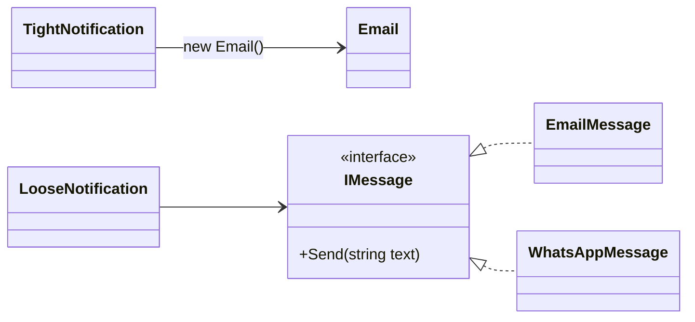
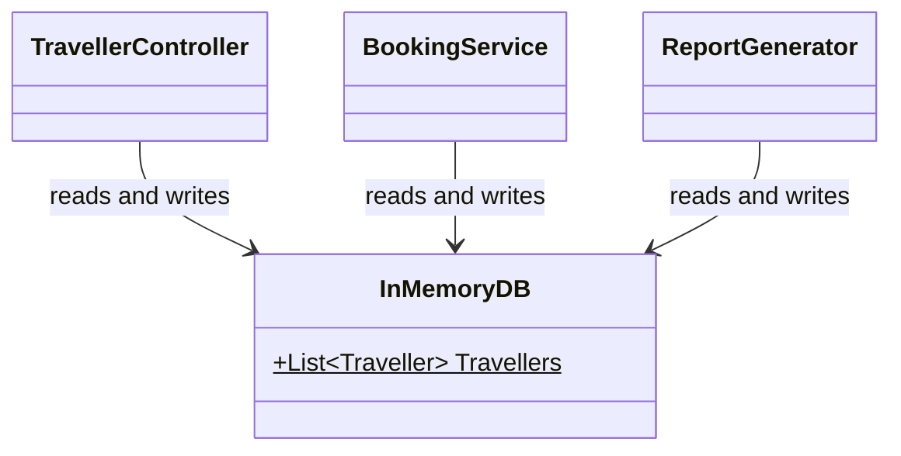

# Coupling

Coupling measures how much **one class depends on another**. If I change class B, how much of class A breaks?

> [!IMPORTANT]
> Aim for **low (loose) coupling**. Together with high [cohesion](Cohesion.md), it makes code easy to change, reuse and test.

---

#### TOC

- [Tight vs loose coupling](#tight-vs-loose-coupling)
- [The 5 types, worst to best](#the-5-types-worst-to-best)
- [Content coupling](#content-coupling)
- [Common coupling](#common-coupling)
- [Control coupling](#control-coupling)
- [Stamp coupling](#stamp-coupling)
- [Data coupling](#data-coupling)
- [Cohesion vs coupling](#cohesion-vs-coupling)

---

## Tight vs loose coupling

Coupling states that:

- **Tight coupling**: a class knows the concrete details of another class. Change one, and the other breaks.
- **Loose coupling**: a class only knows an **interface**, so the class behind it can change freely.



_Example:_

```csharp
// -------- Bad practice (tight) ---------
class Notification {
    private Email email = new Email();
    public void Notify(string text) {
        email.Send(text);
    }
}
```

```csharp
// -------- Good practice (loose) ---------
class Notification {
    private IMessage message;
    public Notification(IMessage message) {
        this.message = message;
    }
    public void Notify(string text) {
        message.Send(text);
    }
}
```

In the above example, the tight Notification is stuck with Email and can't be tested without sending a real email. The loose one works with any `IMessage`. This is D in [SOLID](SOLID.md).

## The 5 types, worst to best


_Red = bad, yellow = okay, green = good._

> [!TIP]
> To spot the type, ask: **what** do these two classes share?

| Type    | They share...                                  |
| ------- | ---------------------------------------------- |
| Content | Each other's **private internals**             |
| Common  | A **global** (static) variable                 |
| Control | A **flag** that decides what the other does    |
| Stamp   | A **whole object**, when only part is needed   |
| Data    | Only the **simple values** that are needed     |

## Content coupling

Content coupling is:

- One class reaches into **another class's internals** and uses or changes them directly. The worst kind.

_Example:_

```csharp
class Hacker {
    public void ResetPoints(Traveller traveller) {
        typeof(Traveller)
            .GetField("points", BindingFlags.NonPublic | BindingFlags.Instance)
            .SetValue(traveller, 0); // changes a private field
    }
}
```

In the above example, if Traveller renames `points`, Hacker breaks, and the compiler won't warn us. The fix: ask Traveller to do it through a public method like `traveller.ResetPoints()` (encapsulation).

## Common coupling

Common coupling is:

- Several classes read and write the **same global** (static) data.



_Example:_

```csharp
class InMemoryDB {
    public static List<Traveller> Travellers = new List<Traveller>();
}

class BookingService {
    public void Book(int id) {
        Traveller t = InMemoryDB.Travellers.Find(x => x.Id == id);
        // ...
    }
}
```

In the above example, any class can change `Travellers` at any time, so a bug in one class can show up in another. The fix: pass a repository in through an interface (see [Scenario](Scenario.md)).

## Control coupling

Control coupling is:

- One class passes a **flag** that tells the other class **what to do**.

_Example:_

```csharp
// -------- Bad practice ---------
class Printer {
    public void Print(Report report, bool asPdf) {
        if (asPdf) { /* PDF code */ }
        else { /* text code */ }
    }
}

printer.Print(report, true); // caller decides the path inside Print
```

```csharp
// -------- Good practice ---------
class Printer {
    public void PrintPdf(Report report) { /* PDF code */ }
    public void PrintText(Report report) { /* text code */ }
}
```

In the above example, the caller of the bad version must know how `Print` works inside. With two clear methods, the flag is gone.

## Stamp coupling

Stamp coupling is:

- One class passes a **whole object** when the other only needs **part** of it.

_Example:_

```csharp
// -------- Bad practice ---------
class Mailer {
    public void SendWelcome(Traveller traveller) {
        Send(traveller.Email, "Welcome!"); // only uses Email
    }
}
```

```csharp
// -------- Good practice ---------
class Mailer {
    public void SendWelcome(string email) {
        Send(email, "Welcome!");
    }
}
```

In the above example, the bad Mailer depends on the whole Traveller class, so any change to Traveller could affect it. The good one only needs a string.

> [!NOTE]
> Passing objects is not always bad. If a method genuinely needs most of the object, passing it is fine.

## Data coupling

Data coupling is:

- Classes only share the **simple values** they need, through parameters. The best kind.

_Example:_

```csharp
class TaxCalculator {
    public double Calculate(double income) {
        // only knows about one number
    }
}

double tax = calculator.Calculate(50000);
```

In the above example, TaxCalculator knows nothing about who calls it or where the income came from. Either side can change freely.

## Cohesion vs coupling

|                 | Cohesion                              | Coupling                                  |
| --------------- | ------------------------------------- | ----------------------------------------- |
| Looks at        | **Inside** one class                  | **Between** classes                       |
| Question        | Do the parts belong together?         | How much do classes depend on each other? |
| Aim for         | **High**                              | **Low**                                   |
| Related SOLID   | S (one job per class)                 | D (depend on interfaces)                  |

> [!IMPORTANT]
> **High cohesion, low coupling.** Each class does one job well, and talks to others through small, simple connections.
