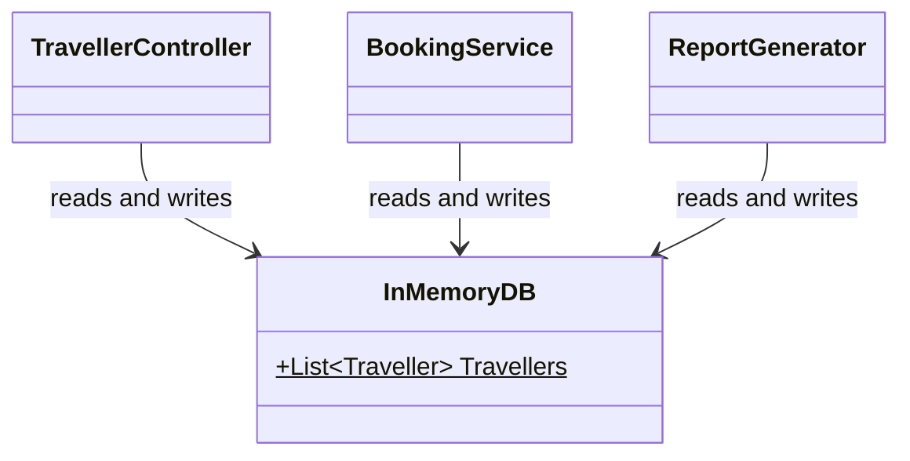

# Coupling

Coupling is **the degree of interdependence between classes**. If I change class B, how much of class A breaks?

> [!IMPORTANT]
> Aim for **low coupling** and **high [cohesion](Cohesion.md)**. That's good modularization.

---

#### TOC

- [Low vs high coupling](#low-vs-high-coupling)
- [Stamp coupling → Data coupling](#stamp-coupling--data-coupling)
- [Temporal coupling](#temporal-coupling)
- [Common coupling](#common-coupling)
- [Content coupling](#content-coupling)
- [Control coupling](#control-coupling)
- [Cohesion vs coupling](#cohesion-vs-coupling)

---

## Low vs high coupling

| Advantages of **low** coupling                                                        | Disadvantages of **high** coupling                                                 |
| ------------------------------------------------------------------------------------- | ---------------------------------------------------------------------------------- |
| **Improved maintainability**: easier to replace or modify a class without breaking the whole system | **Increased complexity**: classes depend more on each other              |
| **Enhanced modularity**: classes can be developed and tested in isolation, and reused | **Reduced flexibility**: harder to modify or replace one part without affecting the whole system |
| **Better scalability**: easier to add new classes or remove existing ones             | **Decreased modularity**: harder to develop and test classes in isolation, less reuse |

> [!TIP]
> To spot the type, ask: **what** do these two classes share?

| Type     | The problem                                             | Fix                                         |
| -------- | ------------------------------------------------------- | ------------------------------------------- |
| Stamp    | Passing a **whole object** when only part is needed     | Only pass the fields needed (data coupling) |
| Temporal | Methods must be called in a **certain order**           | Use constructors and methods to force the order |
| Common   | Classes share the same **global** data                  | Encapsulation and data ownership            |
| Content  | A class changes **another class's internal** data       | Encapsulation                               |
| Control  | Passing a **flag** that decides what the other class does | Extract method, encapsulation, polymorphism |

## Stamp coupling → Data coupling

Stamp coupling is:

- Passing a **whole object** when the method only needs **part** of it.
- Fix: only pass the fields you need. That turns it into **data coupling**.

_Example:_

```csharp
// -------- Bad practice (stamp coupling) ---------
class Mailer {
    public void SendWelcome(Traveller traveller) {
        Send(traveller.Email, "Welcome!"); // only uses Email
    }
}
```

```csharp
// -------- Good practice (data coupling) ---------
class Mailer {
    public void SendWelcome(string email) {
        Send(email, "Welcome!");
    }
}
```

In the above example, the bad Mailer depends on the whole Traveller class, so any change to Traveller could affect it. The good one only needs a string.

## Temporal coupling

Temporal coupling is:

- Methods that only work if they're called in the **right order**. Call them in the wrong order and it breaks.
- Fix: make sure the statements always run in the correct order, e.g. use **constructors** and **methods** to force it.

_Example:_

```csharp
// -------- Bad practice ---------
class SalesReport {
    private List<Sale> sales;

    public void Load(List<Sale> sales) {
        this.sales = sales;
    }
    public void Print() {
        foreach (Sale sale in sales) { /* ... */ } // crashes if Load() wasn't called first
    }
}

SalesReport report = new SalesReport();
report.Print(); // forgot Load() -> NullReferenceException
```

```csharp
// -------- Good practice ---------
class SalesReport {
    private List<Sale> sales;

    public SalesReport(List<Sale> sales) { // can't create a report without sales
        this.sales = sales;
    }
    public void Print() {
        foreach (Sale sale in sales) { /* ... */ }
    }
}
```

In the above example, the caller of the bad version has to remember to call `Load()` before `Print()`. The good version takes the sales in its constructor, so a report can't exist without them and the wrong order is impossible.

## Common coupling

Common coupling is:

- Several classes read and write the **same shared (global) data**.
- Fix: use **encapsulation** and **data ownership**. One class owns the data, and the others ask it through methods.



_Example:_

```csharp
// -------- Bad practice ---------
class InMemoryDB {
    public static List<Traveller> Travellers = new List<Traveller>();
}

// any class can do this, anywhere
InMemoryDB.Travellers.Clear();
```

```csharp
// -------- Good practice ---------
class TravellerStore {
    private List<Traveller> travellers = new List<Traveller>(); // owned by this class

    public void Add(Traveller traveller) {
        travellers.Add(traveller);
    }
    public Traveller FindById(int id) {
        return travellers.Find(t => t.Id == id);
    }
}
```

In the above example, any class can change the bad `Travellers` list at any time, so a bug in one class shows up in another. In the good version only `TravellerStore` touches the list, and everyone else goes through its methods (see [Scenario](Scenario.md)).

## Content coupling

Content coupling is:

- One class reaches into **another class's internal data** and changes it directly.
- Fix: use **encapsulation**, so a class is the only one that can change its own internal data.

_Example:_

```csharp
// -------- Bad practice ---------
class Traveller {
    public int points; // anyone can change it
}

class Booking {
    public void Book(Traveller traveller) {
        traveller.points -= 500; // Booking changes Traveller's data
    }
}
```

```csharp
// -------- Good practice ---------
class Traveller {
    private int points;

    public bool SpendPoints(int amount) {
        if (amount > points) return false;
        points -= amount;
        return true;
    }
}

class Booking {
    public void Book(Traveller traveller) {
        traveller.SpendPoints(500); // Traveller changes its own data
    }
}
```

In the above example, the bad Booking depends on how Traveller stores its points, and can even make them negative. In the good version Traveller owns its data and its rules.

## Control coupling

Control coupling is:

- One class passes a **flag** that tells the other class **what to do**.
- Fix: use **extract method**, **encapsulation** and **polymorphism** to limit the control outside classes have.

_Example:_

```csharp
// -------- Bad practice ---------
class Printer {
    public void Print(Report report, bool asPdf) {
        if (asPdf) { /* PDF code */ }
        else { /* text code */ }
    }
}

printer.Print(report, true); // caller decides the path inside Print
```

```csharp
// -------- Good practice: extract method ---------
class Printer {
    public void PrintPdf(Report report) { /* PDF code */ }
    public void PrintText(Report report) { /* text code */ }
}
```

```csharp
// -------- Good practice: polymorphism ---------
abstract class ReportPrinter {
    public abstract void Print(Report report);
}

class PdfPrinter : ReportPrinter {
    public override void Print(Report report) { /* PDF code */ }
}

class TextPrinter : ReportPrinter {
    public override void Print(Report report) { /* text code */ }
}
```

In the above example, the caller of the bad version must know how `Print` works inside. Extracting two methods removes the flag. With polymorphism, the caller just picks a printer and calls `Print`.

## Cohesion vs coupling

|           | Cohesion                                | Coupling                                  |
| --------- | --------------------------------------- | ----------------------------------------- |
| Looks at  | **Inside** one class                    | **Between** classes                       |
| Question  | Do the members work towards one job?    | How much do classes depend on each other? |
| Aim for   | **High**                                | **Low**                                   |

> [!IMPORTANT]
> **Bad modularization**: low cohesion, high coupling. **Good modularization**: high cohesion, low coupling.
