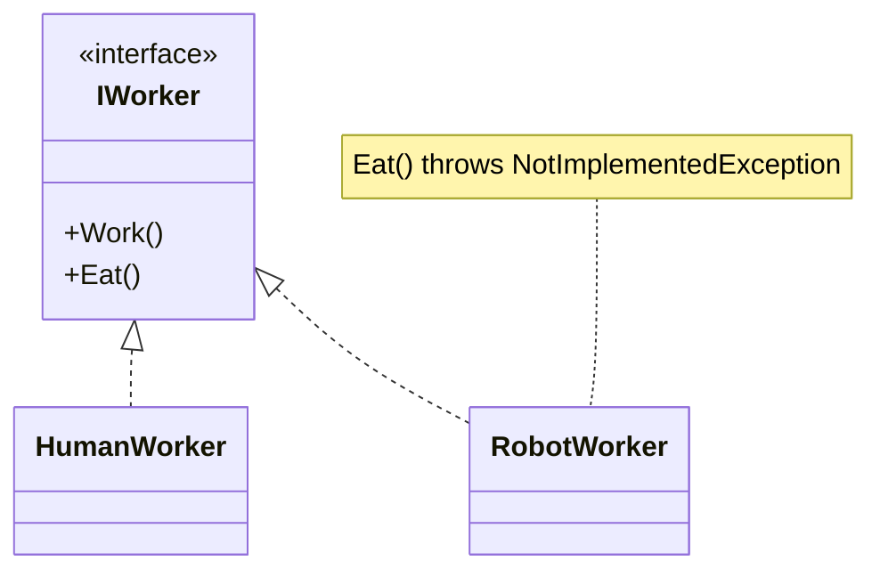
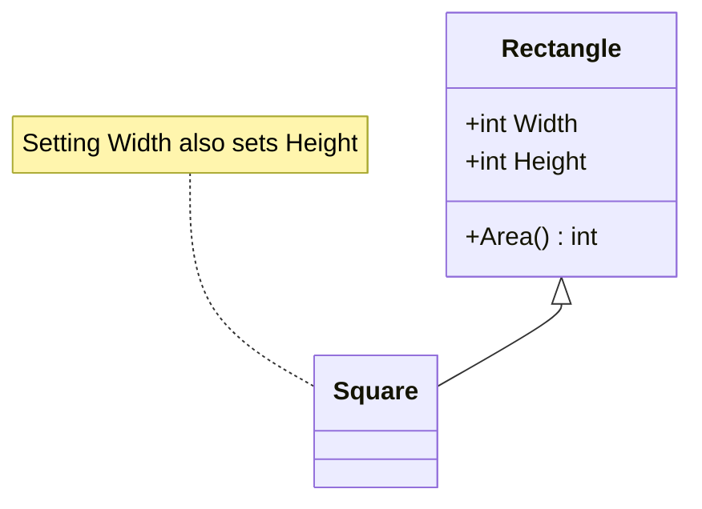
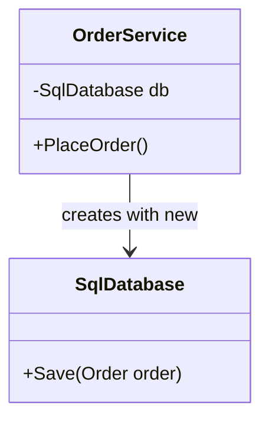
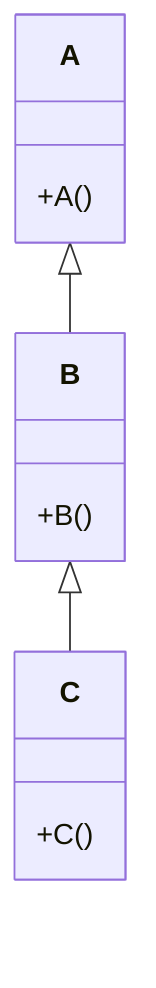
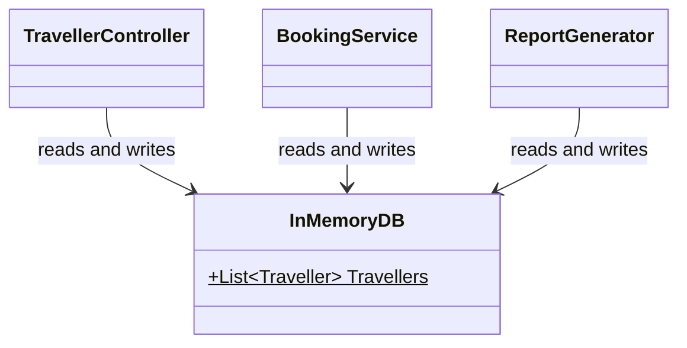
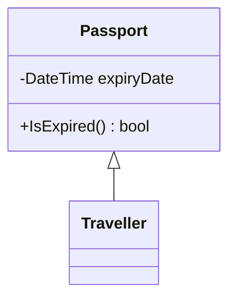
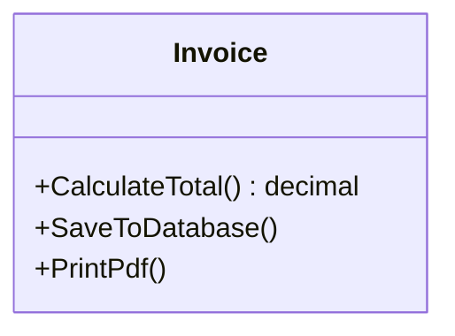

# MCQ Practice

### Q1

In the design below, `RobotWorker` cannot eat, so its `Eat()` throws `NotImplementedException`. Which SOLID principle does the design of the `IWorker` interface violate?



**a.** Single Responsibility Principle.\
**b.** Open-Closed Principle.\
**c.** Dependency Inversion Principle.\
**d.** Liskov Substitution Principle.\
**e.** Interface Segregation Principle.

### Q2

Methods in a class are grouped because they must be called in a certain order (e.g. `CheckPassword()` then `LoadMenu()`), even though they work on different data. This is an example of:

**a.** Procedural cohesion\
**b.** Sequential cohesion\
**c.** Functional cohesion\
**d.** Logical cohesion\
**e.** Communicational cohesion

### Q3

Tests that are written only from the specification and contract of a method, without looking at its source code, are called:

**a.** Glass box tests\
**b.** Black box tests\
**c.** Integration tests\
**d.** Performance tests\
**e.** Security tests

### Q4

What does the code below print?

```csharp
void AddTen(int x) {
    x += 10;
}

void AddTenRef(ref int x) {
    x += 10;
}

int a = 5;
int b = 5;
AddTen(a);
AddTenRef(ref b);
Console.Write(a + " " + b);
```

**a.** `5 5`\
**b.** `15 15`\
**c.** `15 5`\
**d.** `5 15`\
**e.** Compile-time error.

### Q5

Consider these statements about **overloaded** methods in C#:

**I.** They must have the same identifier.\
**II.** They must have different parameter lists.\
**III.** They can differ only by their return type.

Which statements are correct?

**a.** I only\
**b.** I and II only\
**c.** II and III only\
**d.** I, II and III\
**e.** None of the above

### Q6

What does the code below do?

```csharp
class Traveller {
    public virtual string GetTier() {
        return "Standard";
    }
}

class GoldTraveller : Traveller {
    public override string GetTier() {
        return "Gold";
    }
}

List<Traveller> travellers = new List<Traveller>();
travellers.Add(new Traveller());
travellers.Add(new GoldTraveller());

foreach (Traveller t in travellers) {
    Console.WriteLine(t.GetTier());
}
```

**a.** Compile-time error, because a `List<Traveller>` cannot store a `GoldTraveller`.\
**b.** Prints `Standard`, then `Standard`, because the list only knows about `Traveller`.\
**c.** Prints `Standard`, then `Gold`.\
**d.** Throws `InvalidCastException` at run time.\
**e.** Prints `Gold`, then `Gold`.

### Q7

A developer reads the source code of `IncomeTax`, notices a special `if` branch for an income of exactly 18200, and writes a test for that case. This is an example of:

**a.** Glass box testing\
**b.** Black box testing\
**c.** Acceptance testing\
**d.** Regression testing\
**e.** System testing

### Q8

In C#, which statement about `ref` and `out` parameters is correct?

**a.** `ref` and `out` behave exactly the same.\
**b.** A `ref` variable must be assigned before it is passed in; an `out` parameter must be assigned inside the method before it returns.\
**c.** An `out` variable must be assigned before it is passed in; a `ref` parameter must be assigned inside the method.\
**d.** Both only work with reference types such as classes.\
**e.** Both pass a copy of the value, so the caller never sees changes.

### Q9

`Print(report, true)` prints a PDF and `Print(report, false)` prints plain text. The caller passes a flag that decides what the method does. Which type of coupling is this?

**a.** Data coupling\
**b.** Stamp coupling\
**c.** Control coupling\
**d.** Content coupling\
**e.** Common coupling

### Q10

`Penguin` inherits from `Bird`, and `Penguin.Fly()` throws an exception. Which redesign best fixes the problem?

**a.** Wrap every call to `Fly()` in a try-catch.\
**b.** Move `Fly()` into a separate `FlyingBird` class (or `IFlyable` interface) that only flying birds use.\
**c.** Make `Penguin.Fly()` do nothing and return silently.\
**d.** Make `Bird` a sealed class.\
**e.** Check `if (bird is Penguin)` before every call to `Fly()`.

### Q11

What does the code below print?

```csharp
class A {
    public void Show() {
        Console.Write("A");
    }
}

class B : A {
    public new void Show() {
        Console.Write("B");
    }
}

A obj = new B();
obj.Show();
```

**a.** A\
**b.** B\
**c.** AB\
**d.** BA\
**e.** Compile-time error.

### Q12

After fixing a bug, a developer re-runs all the existing tests to make sure everything that worked before the change still works. This is:

**a.** Acceptance testing\
**b.** Performance testing\
**c.** Security testing\
**d.** Integration testing\
**e.** Regression testing

### Q13

In the code below, `Print()` crashes with a `NullReferenceException` if `Load()` has not been called first. Which type of coupling is this?

```csharp
class SalesReport {
    private List<Sale> sales;

    public void Load(List<Sale> sales) {
        this.sales = sales;
    }
    public void Print() {
        foreach (Sale sale in sales) { /* ... */ }
    }
}

SalesReport report = new SalesReport();
report.Print();
```

**a.** Content coupling\
**b.** Common coupling\
**c.** Control coupling\
**d.** Stamp coupling\
**e.** Temporal coupling

### Q14

What is the difference between **overloading** and **overriding** a method in C#?

**a.** They are the same thing; both just mean writing a method with the same name twice.\
**b.** Overloading needs `virtual` and `override`; overriding needs a different parameter list.\
**c.** Overloading changes only the return type; overriding changes only the method name.\
**d.** Overloading only works across a parent and child class; overriding only works inside one class.\
**e.** Overloading means the same method name with a different parameter list; overriding means a child class replaces a parent's `virtual` method, keeping the same signature.

### Q15

In the design below, setting `Width` on a `Square` also changes its `Height`. A method that takes a `Rectangle`, sets `Width = 5` and `Height = 4`, then expects `Area() == 20`, fails when given a `Square`. Which SOLID principle is violated?



**a.** Single Responsibility Principle.\
**b.** Open-Closed Principle.\
**c.** Liskov Substitution Principle.\
**d.** Interface Segregation Principle.\
**e.** Dependency Inversion Principle.

### Q16

`SendWelcomeEmail(Traveller traveller)` only uses `traveller.Email`, but receives the whole `Traveller` object. Which type of coupling is this?

**a.** Stamp coupling\
**b.** Data coupling\
**c.** Control coupling\
**d.** Common coupling\
**e.** Content coupling

### Q17

Consider these statements about **overriding** a method in C#:

**I.** The child method has the same identifier as the parent method.\
**II.** The child method has the same parameter list as the parent method.\
**III.** The parent method must be marked `virtual`, `abstract` or `override`.

Which statements are correct?

**a.** I only\
**b.** I and II only\
**c.** II and III only\
**d.** I, II and III\
**e.** None of the above

### Q18

A `Utils` class contains `FormatDate()`, `CalculateTax()` and `SendEmail()`, which have nothing in common. This is an example of:

**a.** Coincidental cohesion\
**b.** Logical cohesion\
**c.** Temporal cohesion\
**d.** Functional cohesion\
**e.** Sequential cohesion

### Q19

`GoldTraveller` inherits from `Traveller`. What happens with the code below?

```csharp
List<GoldTraveller> golds = new List<GoldTraveller>();
List<Traveller> travellers = golds;
```

**a.** It compiles, because a `GoldTraveller` is a `Traveller`.\
**b.** It compiles, but throws `InvalidCastException` at run time.\
**c.** It compiles, and `travellers` becomes a copy of `golds`.\
**d.** Compile-time error: a `List<GoldTraveller>` is not a `List<Traveller>`, even though a `GoldTraveller` is a `Traveller`.\
**e.** None of the above.

### Q20

How should the class below be changed to follow the Dependency Inversion Principle?

```csharp
class OrderService {
    private SqlDatabase db = new SqlDatabase();
}
```

**a.** Make `SqlDatabase` a static class.\
**b.** Make `OrderService` inherit from `SqlDatabase`.\
**c.** Depend on an `IDatabase` interface and receive it through the constructor.\
**d.** Copy the database code into `OrderService`.\
**e.** Make the `db` field public.

### Q21

`TravellerController.Book()` checks the traveller's points, subtracts the cost, and prints "Booked!" with `Console.WriteLine`, while `Traveller` only has `{ get; set; }` properties. Which statement is the most accurate?

**a.** This is the recommended "fat model, thin controller" design.\
**b.** The controller is a good example of the Interface Segregation Principle.\
**c.** This is a fat controller with an anemic model: the controller does the Model's job and the View's job.\
**d.** This follows MVC because all the code is in one place.\
**e.** None of the above.

### Q22

Income is tax-free up to and including $18200. Which pair of inputs best tests the **boundary** of this rule?

**a.** 100 and 20000\
**b.** -1 and 1000000\
**c.** 5000 and 10000\
**d.** 18200 and 18201\
**e.** 0 and 100

### Q23

A `DiscountCalculator` has a `switch` on the customer type that must be edited every time a new customer type is added. What is the best way to fix it?

**a.** Add a comment reminding developers to update the switch.\
**b.** Replace the switch with a chain of if-else statements.\
**c.** Move the switch into the Main method.\
**d.** Make the customer type a public field so any class can change it.\
**e.** Give each customer type its own class that overrides a virtual `GetDiscount()` method.

### Q24

Class `A` changes a private field of class `B` directly using reflection. Which type of coupling is this?

**a.** Data coupling\
**b.** Stamp coupling\
**c.** Control coupling\
**d.** Content coupling\
**e.** Common coupling

### Q25

A `Startup` class contains `InitLogger()`, `LoadConfig()` and `OpenDatabase()`. They are grouped only because they all run when the program starts. This is an example of:

**a.** Coincidental cohesion\
**b.** Logical cohesion\
**c.** Temporal cohesion\
**d.** Communicational cohesion\
**e.** Functional cohesion

### Q26

A `DiscountCalculator` has a `switch` on the customer type ("Regular", "Silver", "Gold"). Every time a new customer type is added, a developer must edit this `switch`. Which SOLID principle is violated?

**a.** Single Responsibility Principle.\
**b.** Open-Closed Principle.\
**c.** Liskov Substitution Principle.\
**d.** Interface Segregation Principle.\
**e.** Dependency Inversion Principle.

### Q27

Consider these statements:

**I.** Overloading is resolved at compile time.\
**II.** Overriding is resolved at run time.\
**III.** Overriding happens between two methods in the same class.\
**IV.** Overloading requires the `virtual` keyword.

Which statements are correct?

**a.** I and II only\
**b.** III and IV only\
**c.** I, II and III only\
**d.** All of them\
**e.** None of them

### Q28

A method's contract says nothing about what happens when the input is negative. Should the test plan include a test with input `-1`?

**a.** Yes, every test plan must include negative input.\
**b.** Yes, and the expected outcome is an `ArgumentException`.\
**c.** No, because if the contract does not say what happens with invalid input, you cannot test with invalid input.\
**d.** No, because negative numbers cannot be passed to methods in C#.\
**e.** Yes, and the expected outcome is 0.

### Q29

In the design below, `OrderService` creates its own `SqlDatabase` with `new SqlDatabase()`. Which SOLID principle does this violate most directly?



**a.** Liskov Substitution Principle.\
**b.** Interface Segregation Principle.\
**c.** Open-Closed Principle.\
**d.** Single Responsibility Principle.\
**e.** Dependency Inversion Principle.

### Q30

Each constructor below writes its own class name with `Console.Write`. What does `new C();` print?



**a.** C\
**b.** CBA\
**c.** ABC\
**d.** AC\
**e.** Compile-time error.

### Q31

What does the code below print?

```csharp
class Animal { }
class Dog : Animal { }

void Speak(Animal a) {
    Console.Write("Animal ");
}

void Speak(Dog d) {
    Console.Write("Dog ");
}

Animal pet = new Dog();
Speak(pet);
Speak(new Dog());
```

**a.** `Dog Dog`\
**b.** `Animal Dog`\
**c.** `Animal Animal`\
**d.** `Dog Animal`\
**e.** Compile-time error, because the call is ambiguous.

### Q32

In the design below, several classes read and write `InMemoryDB.Travellers`, a `public static` list. Which type of coupling is this?



**a.** Data coupling\
**b.** Common coupling\
**c.** Stamp coupling\
**d.** Control coupling\
**e.** Content coupling

### Q33

In MSTest, which attribute marks a method that must run **before every test** in the class?

**a.** `[TestClass]`\
**b.** `[TestMethod]`\
**c.** `[DataRow]`\
**d.** `[TestInitialize]`\
**e.** `[Timeout]`

### Q34

What happens when the code below is compiled?

```csharp
class Person {
    public Person(string name) { }
}

class Student : Person {
    public Student() { }
}
```

**a.** It compiles, and Person's constructor is skipped.\
**b.** It compiles, and name is set to null.\
**c.** It compiles, but throws an exception at run time.\
**d.** Compile-time error, because Person has no parameterless constructor and Student does not call base(...).\
**e.** None of the above.

### Q35

A developer designs the classes below so that `Traveller` can reuse `IsExpired()`. What is the better design?



**a.** Make `Passport` inherit from `Traveller`.\
**b.** Make `IsExpired()` static.\
**c.** Copy `IsExpired()` into `Traveller`.\
**d.** Make `Passport` an interface with all of Traveller's methods.\
**e.** Use composition: `Traveller` has a private `Passport` field and calls `passport.IsExpired()`.

### Q36

A class has `ReadFile()`, `ParseLines()` and `SaveRecords()`, where the output of each method is the input of the next, like an assembly line. This is an example of:

**a.** Procedural cohesion\
**b.** Communicational cohesion\
**c.** Temporal cohesion\
**d.** Sequential cohesion\
**e.** Coincidental cohesion

### Q37

A `ReportGenerator` class loads sales data from the database, formats it as HTML, and emails it to the manager. Which description fits best?

**a.** Low cohesion and a violation of SRP; it should be split into separate classes for loading, formatting and sending.\
**b.** High cohesion, and it follows SRP.\
**c.** Loose coupling, and it follows ISP.\
**d.** Functional cohesion, and it follows OCP.\
**e.** None of the above.

### Q38

`Run()` is called. What is printed?

```csharp
void Run() {
    try { MethodA(); }
    catch (Exception) { Console.Write("Run "); }
}

void MethodA() {
    try { MethodB(); }
    catch (Exception) { Console.Write("A "); }
}

void MethodB() {
    MethodC();
    Console.Write("B ");
}

void MethodC() {
    throw new Exception();
}
```

**a.** `Run`\
**b.** `A`\
**c.** `B A`\
**d.** `A Run`\
**e.** Nothing, the program terminates.

### Q39

Which SOLID principle does the `Invoice` class below violate?



**a.** Single Responsibility Principle.\
**b.** Open-Closed Principle.\
**c.** Liskov Substitution Principle.\
**d.** Interface Segregation Principle.\
**e.** Dependency Inversion Principle.

### Q40

What does `new B();` print?

```csharp
class A {
    public A() {
        Show();
    }
    public virtual void Show() {
        Console.Write("A");
    }
}

class B : A {
    private string name = "B";

    public B() {
        name = "C";
    }
    public override void Show() {
        Console.Write(name);
    }
}
```

**a.** A\
**b.** B\
**c.** C\
**d.** Nothing, because name is still null.\
**e.** Compile-time error.

---

## Answer key

| Q | Answer | Q | Answer | Q | Answer |
| - | - | - | - | - | - |
| [Q1](#q1) | e | [Q15](#q15) | c | [Q29](#q29) | e |
| [Q2](#q2) | a | [Q16](#q16) | a | [Q30](#q30) | c |
| [Q3](#q3) | b | [Q17](#q17) | d | [Q31](#q31) | b |
| [Q4](#q4) | d | [Q18](#q18) | a | [Q32](#q32) | b |
| [Q5](#q5) | b | [Q19](#q19) | d | [Q33](#q33) | d |
| [Q6](#q6) | c | [Q20](#q20) | c | [Q34](#q34) | d |
| [Q7](#q7) | a | [Q21](#q21) | c | [Q35](#q35) | e |
| [Q8](#q8) | b | [Q22](#q22) | d | [Q36](#q36) | d |
| [Q9](#q9) | c | [Q23](#q23) | e | [Q37](#q37) | a |
| [Q10](#q10) | b | [Q24](#q24) | d | [Q38](#q38) | b |
| [Q11](#q11) | a | [Q25](#q25) | c | [Q39](#q39) | a |
| [Q12](#q12) | e | [Q26](#q26) | b | [Q40](#q40) | b |
| [Q13](#q13) | e | [Q27](#q27) | a |  |  |
| [Q14](#q14) | e | [Q28](#q28) | c |  |  |

---

## Solutions

**[Q1](#q1) — e.** Interface Segregation Principle

`IWorker` is a fat interface: it forces `RobotWorker` to have an `Eat()` it can't do. The fix is to split it into small interfaces like `IWorkable` and `IEatable`, so each class only picks what it can do. (The throwing `Eat()` also smells like LSP, but the question asks what's wrong with the *interface*.)

**[Q2](#q2) — a.** Procedural cohesion

The methods are grouped because they run in a fixed order, but they don't pass data to each other. If the output of one were the input of the next, it would be sequential cohesion instead.

**[Q3](#q3) — b.** Black box tests

Black box tests only use the specification (what the method should do), not the implementation. Glass box tests are the opposite: you read the source code to find special cases that might cause problems.

**[Q4](#q4) — d.** `5 15`

`AddTen(a)` gets a **copy** of `a`, so the change is lost and `a` stays 5. `AddTenRef(ref b)` gets the variable itself, so `b` really becomes 15.

**[Q5](#q5) — b.** I and II only

I and II are correct: overloads share a name but need different parameters (type, number or order). III is wrong: two methods that differ **only** by return type don't compile, because the compiler can't tell which one a call means.

**[Q6](#q6) — c.** Prints `Standard`, then `Gold`

A `List<Traveller>` can hold a `GoldTraveller`, because a `GoldTraveller` **is a** `Traveller`. `GetTier()` is `virtual`/`override`, so each object runs its own version: `Standard` for `Traveller`, `Gold` for `GoldTraveller`. This is polymorphism.

**[Q7](#q7) — a.** Glass box testing

The test came from looking **inside** the implementation, so it's a glass box test. A black box test would only use the specification.

**[Q8](#q8) — b.** A `ref` variable must be assigned before it is passed in; an `out` parameter must be assigned inside the method before it returns

`ref` passes a variable that already has a value (the method can read and change it). `out` is for returning a value: the caller doesn't need to set it first, but the method **must** assign it before it returns.

**[Q9](#q9) — c.** Control coupling

The flag (`true`/`false`) controls which path runs inside `Print`. When one module tells another *how* to behave, that's control coupling. Two clearer methods, `PrintPdf()` and `PrintText()`, would remove it.

**[Q10](#q10) — b.** Move `Fly()` into a separate `FlyingBird` class (or `IFlyable` interface) that only flying birds use

A `Penguin` can't stand in for a `Bird` if every `Bird` can fly, which breaks LSP. Moving `Fly()` into `FlyingBird` (or an `IFlyable` interface) means only birds that can fly promise to fly. Doing nothing silently (c) still breaks what callers expect.

**[Q11](#q11) — a.** A

`new` **hides** the parent method instead of overriding it. With hiding, the **variable's type** decides which method runs. `obj` is declared as `A`, so `A.Show()` runs. With `virtual`/`override` it would print `B`.

**[Q12](#q12) — e.** Regression testing

Regression testing checks that a code change hasn't broken existing functionality: everything that worked before still works after.

**[Q13](#q13) — e.** Temporal coupling

`Print()` only works if `Load()` was called first, so the caller has to remember the right order. That's temporal coupling. The fix is to use constructors and methods to force the order, e.g. pass the sales into the constructor so a report can't exist without them.

**[Q14](#q14) — e.** Overloading means the same method name with a different parameter list; overriding means a child class replaces a parent's `virtual` method, keeping the same signature

**Overloading** = same name, **different parameters** (e.g. `Print(int)` and `Print(string)`), and the compiler picks which one to call. **Overriding** = a child class gives its own version of a parent's `virtual`/`abstract` method with the **same signature**, using `override`, and the actual object decides which one runs at run time.

**[Q15](#q15) — c.** Liskov Substitution Principle

Code written for a `Rectangle` expects `Width` and `Height` to change separately. A `Square` breaks that expectation, so it can't safely replace a `Rectangle`. That's an LSP violation, even though "a square is a rectangle" in maths.

**[Q16](#q16) — a.** Stamp coupling

Passing a whole object when only one field is needed is stamp coupling. `SendWelcomeEmail` now depends on the whole `Traveller` class. Passing just the email string would be data coupling.

**[Q17](#q17) — d.** I, II and III

All three are correct. An override replaces the parent's version, so it must match its name and parameters, and the parent must allow it with `virtual`, `abstract` or `override`. The child uses the `override` keyword.

**[Q18](#q18) — a.** Coincidental cohesion

The methods are in one class by chance, with no real relationship. That's coincidental cohesion. A `Utils` dumping ground is the classic example.

**[Q19](#q19) — d.** Compile-time error: a `List<GoldTraveller>` is not a `List<Traveller>`, even though a `GoldTraveller` is a `Traveller`

A `GoldTraveller` is a `Traveller`, but a `List<GoldTraveller>` is **not** a `List<Traveller>`. If it were, you could do `travellers.Add(new Traveller())` and put a plain `Traveller` into a list that should only hold Gold ones. So the compiler refuses.

**[Q20](#q20) — c.** Depend on an `IDatabase` interface and receive it through the constructor

Depend on an interface and let the caller pass the real database in through the constructor (dependency injection). Then `OrderService` works with any `IDatabase`, such as SQL now or in-memory for tests.

**[Q21](#q21) — c.** This is a fat controller with an anemic model: the controller does the Model's job and the View's job

The controller holds the business rule (points, cost) **and** prints output, so it's doing the Model's and the View's jobs. Meanwhile `Traveller` is just data. MVC says: fat model, thin controller.

**[Q22](#q22) — d.** 18200 and 18201

Boundary cases sit where the behaviour changes. 18200 is on the boundary (still tax-free) and 18201 is right next to it (first taxed dollar), so together they check the change happens in the right place. 100 and 20000 are typical cases, not boundary cases.

**[Q23](#q23) — e.** Give each customer type its own class that overrides a virtual `GetDiscount()` method

Give each customer type its own class with its own `GetDiscount()`. Adding a new type means adding a new class, without editing tested code. That's OCP done with polymorphism.

**[Q24](#q24) — d.** Content coupling

One class reaching into another's internal data is content coupling. Any change inside `B` can break `A`. The fix is encapsulation: only `B` should change its own data, through its own methods.

**[Q25](#q25) — c.** Temporal cohesion

The methods are grouped only because they run at the same **time** (start-up). That's temporal cohesion.

**[Q26](#q26) — b.** Open-Closed Principle

Every new customer type means editing the existing `switch`. Code should be open for extension (add a new class) but closed for modification (don't edit what already works).

**[Q27](#q27) — a.** I and II only

I and II are correct: the compiler picks an overload from the declared types, while an override is picked at run time from the actual object. III is wrong: overriding needs a parent and a child class. IV is wrong: overloading needs no special keyword; `virtual` is for overriding.

**[Q28](#q28) — c.** No, because if the contract does not say what happens with invalid input, you cannot test with invalid input

You can only write an expected outcome for behaviour the contract defines. In the income tax case study, `-1` is tested only **because** the contract says an `ArgumentException` is thrown. Without that, there's no correct answer to check against.

**[Q29](#q29) — e.** Dependency Inversion Principle

`OrderService` (high-level) creates and depends on the concrete `SqlDatabase` (low-level). DIP says both should depend on an abstraction such as `IDatabase`.

**[Q30](#q30) — c.** ABC

Constructors run from the top of the hierarchy down: `A` first, then `B`, then `C`, so it prints `ABC`.

**[Q31](#q31) — b.** `Animal Dog`

Overloads are chosen at **compile time** from the **declared** type. `pet` is declared as `Animal`, so `Speak(Animal)` runs and prints `Animal`, even though the object is a `Dog`. `new Dog()` has type `Dog`, so it prints `Dog`.

**[Q32](#q32) — b.** Common coupling

Several classes share a global (static) variable, so a change made in one place affects all of them. That's common coupling. The fix is encapsulation and data ownership: one class owns the list privately, and the others go through its methods.

**[Q33](#q33) — d.** `[TestInitialize]`

`[TestInitialize]` runs before each test, so it's used for setup such as creating a fresh object. `[TestClass]` marks the class, `[TestMethod]` marks a test, `[DataRow]` supplies inputs to a `[DataTestMethod]`, and `[Timeout]` limits how long a test can run.

**[Q34](#q34) — d.** Compile-time error, because Person has no parameterless constructor and Student does not call base(...)

Every child constructor calls a parent constructor first. Without `: base(...)`, C# tries to call `Person()` with no arguments, which doesn't exist, so it won't compile. The fix is `public Student() : base("name") { }`.

**[Q35](#q35) — e.** Use composition: `Traveller` has a private `Passport` field and calls `passport.IsExpired()`

A Traveller **has a** passport; it is not a passport. Use composition (keep a `Passport` field) instead of inheritance. Rule of thumb: is-a → inheritance, has-a → composition.

**[Q36](#q36) — d.** Sequential cohesion

Each method's output is the next method's input, like an assembly line. That's sequential cohesion.

**[Q37](#q37) — a.** Low cohesion and a violation of SRP; it should be split into separate classes for loading, formatting and sending

Loading, formatting and emailing are three jobs that change for different reasons. The class has low cohesion and breaks SRP. Split it into a loader, a formatter and a sender.

**[Q38](#q38) — b.** `A`

The exception unwinds the call stack until it finds a handler. `MethodC` and `MethodB` have no `try`/`catch`, so they exit immediately (`B` is never printed). `MethodA` catches it and prints `A`. Once it's caught, it's handled, so `Run`'s `catch` never runs.

**[Q39](#q39) — a.** Single Responsibility Principle

`Invoice` has three jobs: calculating, saving and printing. A change to the database or to the PDF layout would both force edits to `Invoice`. Split it into separate classes.

**[Q40](#q40) — b.** B

Field initialisers run **before** any constructor, including the parent's, so `name` is already `"B"`. The `A` constructor then calls `Show()`, which is virtual, so `B.Show()` runs and prints `B`. Only after that does the `B` constructor body set `name` to `"C"`.
