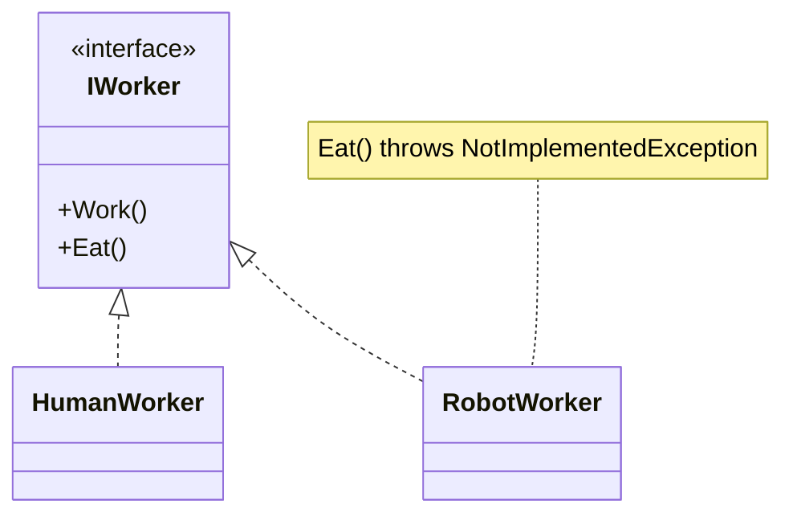
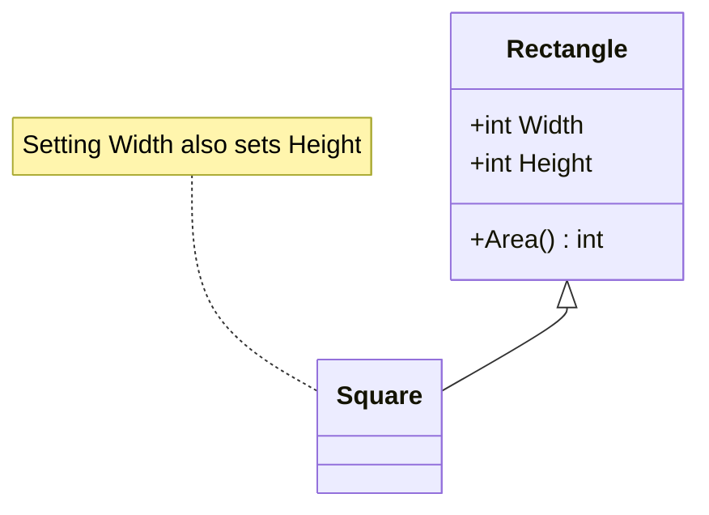
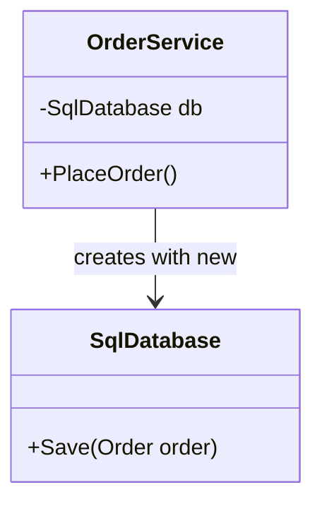
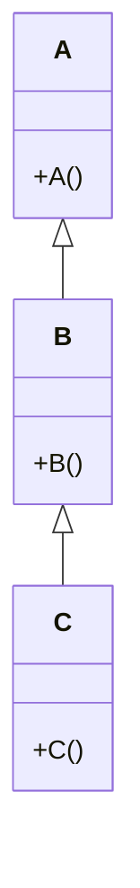
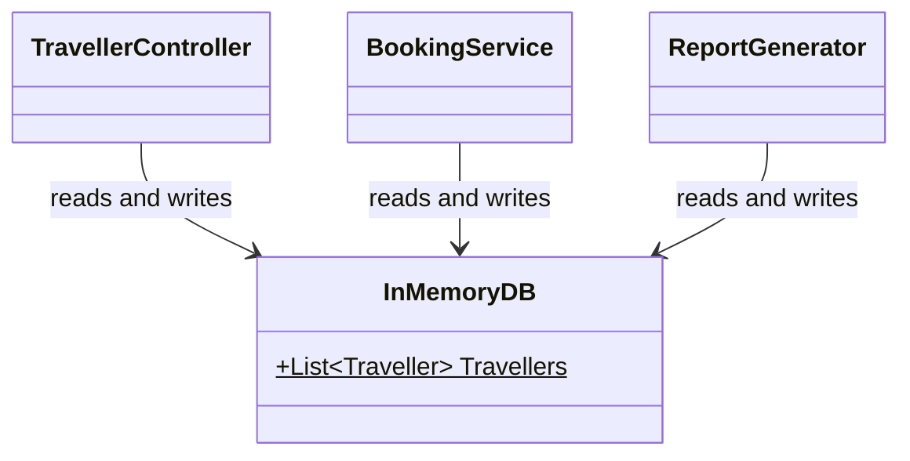
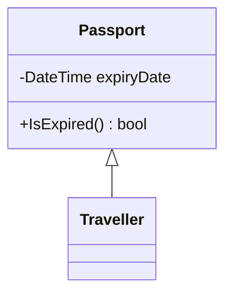
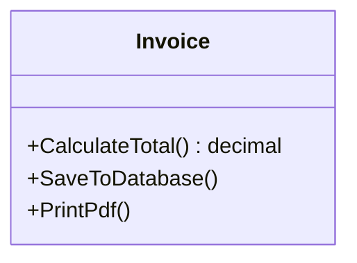

# MCQ Practice

42 questions on constructors and inheritance, SOLID, cohesion, coupling and design case studies. Answers are in the [Answer key](#answer-key) at the end.

---

### Q1

In the design below, `RobotWorker` cannot eat, so its `Eat()` throws `NotImplementedException`. Which SOLID principle does the design of the `IWorker` interface violate?

- **a.** Single Responsibility Principle.
- **b.** Open-Closed Principle.
- **c.** Dependency Inversion Principle.
- **d.** Liskov Substitution Principle.
- **e.** Interface Segregation Principle.

### Q2

Given `class Vehicle { public Vehicle(int wheels) { Console.Write(wheels); } } class Car : Vehicle { public Car() : base(4) { Console.Write("Car"); } }`, what does `new Car();` print?

- **a.** Car4
- **b.** Car
- **c.** 4
- **d.** Compile-time error.
- **e.** 4Car

### Q3

Methods in a class are grouped because they must be called in a certain order (e.g. `CheckPassword()` then `LoadMenu()`), even though they work on different data. This is an example of:

- **a.** Procedural cohesion
- **b.** Sequential cohesion
- **c.** Functional cohesion
- **d.** Logical cohesion
- **e.** Communicational cohesion

### Q4

Given `class Counter { static Counter() { Console.Write("S"); } public Counter() { Console.Write("I"); } }`, what does `new Counter(); new Counter();` print?

- **a.** ISIS
- **b.** SISI
- **c.** II
- **d.** SII
- **e.** IIS

### Q5

Which of the following is NOT one of the SOLID principles?

- **a.** Open-Closed Principle.
- **b.** Liskov Substitution Principle.
- **c.** Don't Repeat Yourself.
- **d.** Interface Segregation Principle.
- **e.** Dependency Inversion Principle.

### Q6

Given `class A { public virtual void Show() { Console.Write("A"); } } class B : A { public override void Show() { base.Show(); Console.Write("B"); } }`, what does `A obj = new B(); obj.Show();` print?

- **a.** A
- **b.** B
- **c.** BA
- **d.** AB
- **e.** Compile-time error.

### Q7

In a booking app, `BookingService` depends on `IFlightRepository`. Switching from `InMemoryFlightRepository` to `SqlFlightRepository` only requires changing one line in `Main`. Which SOLID principle mainly makes this possible?

- **a.** Single Responsibility Principle.
- **b.** Liskov Substitution Principle.
- **c.** Interface Segregation Principle.
- **d.** Dependency Inversion Principle.
- **e.** None of the above.

### Q8

A well-designed system should aim for:

- **a.** Low cohesion and low coupling.
- **b.** Low cohesion and high coupling.
- **c.** High cohesion and low coupling.
- **d.** High cohesion and high coupling.
- **e.** Cohesion and coupling do not matter.

### Q9

Cohesion measures:

- **a.** How many classes depend on a class.
- **b.** How fast a class runs.
- **c.** How many lines of code a class has.
- **d.** How many interfaces a class implements.
- **e.** How closely related the responsibilities inside a single class or module are.

### Q10

The interface `ISuperMachine` declares `Print()`, `Scan()` and `Fax()`. A team adds a new method `Staple()` to it. What is the main problem in a large codebase?

- **a.** The interface becomes slower.
- **b.** Nothing, interfaces can grow freely.
- **c.** Only `SuperMachine` must change.
- **d.** Every class implementing `ISuperMachine`, even simple printers, must now change.
- **e.** The interface can no longer be used as a parameter type.

### Q11

`Print(report, true)` prints a PDF and `Print(report, false)` prints plain text. The caller passes a flag that decides what the method does. Which type of coupling is this?

- **a.** Data coupling
- **b.** Stamp coupling
- **c.** Control coupling
- **d.** Content coupling
- **e.** Common coupling

### Q12

`Penguin` inherits from `Bird`, and `Penguin.Fly()` throws an exception. Which redesign best fixes the problem?

- **a.** Wrap every call to `Fly()` in a try-catch.
- **b.** Move `Fly()` into a separate `FlyingBird` class (or `IFlyable` interface) that only flying birds use.
- **c.** Make `Penguin.Fly()` do nothing and return silently.
- **d.** Make `Bird` a sealed class.
- **e.** Check `if (bird is Penguin)` before every call to `Fly()`.

### Q13

Given `class A { public void Show() { Console.Write("A"); } } class B : A { public new void Show() { Console.Write("B"); } }`, what does `A obj = new B(); obj.Show();` print?

- **a.** A
- **b.** B
- **c.** AB
- **d.** BA
- **e.** Compile-time error.

### Q14

`Notification` depends on the `IMessage` interface instead of the `Email` class. What effect does this have?

- **a.** It reduces coupling, so Notification works with any IMessage (Email, WhatsApp) without changes.
- **b.** It increases coupling between Notification and Email.
- **c.** It increases the cohesion of Email.
- **d.** It makes Notification an anemic model.
- **e.** It has no effect.

### Q15

`BankAccount.Withdraw(amount)` accepts any positive amount. A child class `StudentAccount` overrides it and throws an exception when `amount > 100`. Code that works with `BankAccount` now breaks when given a `StudentAccount`. Which SOLID principle is violated?

- **a.** Interface Segregation Principle.
- **b.** Single Responsibility Principle.
- **c.** Dependency Inversion Principle.
- **d.** Liskov Substitution Principle.
- **e.** Open-Closed Principle.

### Q16

Which type of coupling is the loosest (most desirable)?

- **a.** Content coupling
- **b.** Common coupling
- **c.** Control coupling
- **d.** Stamp coupling
- **e.** Data coupling

### Q17

In the design below, setting `Width` on a `Square` also changes its `Height`. A method that takes a `Rectangle`, sets `Width = 5` and `Height = 4`, then expects `Area() == 20`, fails when given a `Square`. Which SOLID principle is violated?

- **a.** Single Responsibility Principle.
- **b.** Open-Closed Principle.
- **c.** Liskov Substitution Principle.
- **d.** Interface Segregation Principle.
- **e.** Dependency Inversion Principle.

### Q18

A `TaxCalculator` class where every field and method contributes to one task, calculating income tax, is an example of:

- **a.** Functional cohesion
- **b.** Sequential cohesion
- **c.** Communicational cohesion
- **d.** Logical cohesion
- **e.** Temporal cohesion

### Q19

`SendWelcomeEmail(Traveller traveller)` only uses `traveller.Email`, but receives the whole `Traveller` object. Which type of coupling is this?

- **a.** Stamp coupling
- **b.** Data coupling
- **c.** Control coupling
- **d.** Common coupling
- **e.** Content coupling

### Q20

A `Utils` class contains `FormatDate()`, `CalculateTax()` and `SendEmail()`, which have nothing in common. This is an example of:

- **a.** Coincidental cohesion
- **b.** Logical cohesion
- **c.** Temporal cohesion
- **d.** Functional cohesion
- **e.** Sequential cohesion

### Q21

Given `class OrderService { private SqlDatabase db = new SqlDatabase(); }`, how should it be changed to follow the Dependency Inversion Principle?

- **a.** Make `SqlDatabase` a static class.
- **b.** Make `OrderService` inherit from `SqlDatabase`.
- **c.** Depend on an `IDatabase` interface and receive it through the constructor.
- **d.** Copy the database code into `OrderService`.
- **e.** Make the `db` field public.

### Q22

A `CustomerReport` class has methods that print a customer's details, update the customer's address and calculate the customer's balance. All the methods work on the same customer record. This is an example of:

- **a.** Logical cohesion
- **b.** Temporal cohesion
- **c.** Communicational cohesion
- **d.** Coincidental cohesion
- **e.** Procedural cohesion

### Q23

`TravellerController.Book()` checks the traveller's points, subtracts the cost, and prints "Booked!" with `Console.WriteLine`, while `Traveller` only has `{ get; set; }` properties. Which statement is the most accurate?

- **a.** This is the recommended "fat model, thin controller" design.
- **b.** The controller is a good example of the Interface Segregation Principle.
- **c.** This is a fat controller with an anemic model: the controller does the Model's job and the View's job.
- **d.** This follows MVC because all the code is in one place.
- **e.** None of the above.

### Q24

Which list orders cohesion from WORST to BEST?

- **a.** Functional, Sequential, Communicational, Procedural, Temporal, Logical, Coincidental.
- **b.** Coincidental, Temporal, Logical, Functional, Procedural, Communicational, Sequential.
- **c.** Logical, Coincidental, Temporal, Procedural, Sequential, Communicational, Functional.
- **d.** Coincidental, Logical, Temporal, Procedural, Communicational, Sequential, Functional.
- **e.** Temporal, Coincidental, Logical, Procedural, Functional, Sequential, Communicational.

### Q25

A `DiscountCalculator` has a `switch` on the customer type that must be edited every time a new customer type is added. What is the best way to fix it?

- **a.** Add a comment reminding developers to update the switch.
- **b.** Replace the switch with a chain of if-else statements.
- **c.** Move the switch into the Main method.
- **d.** Make the customer type a public field so any class can change it.
- **e.** Give each customer type its own class that overrides a virtual `GetDiscount()` method.

### Q26

`InputHandler.Handle(int source)` reads from the keyboard, a file or the network depending on the `source` flag. The parts are grouped because they are the same kind of thing (input), not because they work together. This is an example of:

- **a.** Coincidental cohesion
- **b.** Logical cohesion
- **c.** Temporal cohesion
- **d.** Sequential cohesion
- **e.** Functional cohesion

### Q27

Class `A` changes a private field of class `B` directly using reflection. Which type of coupling is this?

- **a.** Data coupling
- **b.** Stamp coupling
- **c.** Control coupling
- **d.** Content coupling
- **e.** Common coupling

### Q28

A `Startup` class contains `InitLogger()`, `LoadConfig()` and `OpenDatabase()`. They are grouped only because they all run when the program starts. This is an example of:

- **a.** Coincidental cohesion
- **b.** Logical cohesion
- **c.** Temporal cohesion
- **d.** Communicational cohesion
- **e.** Functional cohesion

### Q29

A `DiscountCalculator` has a `switch` on the customer type ("Regular", "Silver", "Gold"). Every time a new customer type is added, a developer must edit this `switch`. Which SOLID principle is violated?

- **a.** Single Responsibility Principle.
- **b.** Open-Closed Principle.
- **c.** Liskov Substitution Principle.
- **d.** Interface Segregation Principle.
- **e.** Dependency Inversion Principle.

### Q30

Given `class Box { public Box() : this(5) { Console.Write("A"); } public Box(int size) { Console.Write(size); } }`, what does `new Box();` print?

- **a.** 5A
- **b.** A5
- **c.** A
- **d.** 5
- **e.** Throws StackOverflowException.

### Q31

In the design below, `OrderService` creates its own `SqlDatabase` with `new SqlDatabase()`. Which SOLID principle does this violate most directly?

- **a.** Liskov Substitution Principle.
- **b.** Interface Segregation Principle.
- **c.** Open-Closed Principle.
- **d.** Single Responsibility Principle.
- **e.** Dependency Inversion Principle.

### Q32

Each constructor below writes its own class name with `Console.Write`. What does `new C();` print?

- **a.** C
- **b.** CBA
- **c.** ABC
- **d.** AC
- **e.** Compile-time error.

### Q33

Which statement best describes "one reason to change" in the Single Responsibility Principle?

- **a.** A class should have only one method.
- **b.** A class should have only one field.
- **c.** A class should have only one job, so only changes to that job affect it.
- **d.** A class should be changed at most once.
- **e.** A class should never be changed after release.

### Q34

In the design below, several classes read and write `InMemoryDB.Travellers`, a `public static` list. Which type of coupling is this?

- **a.** Data coupling
- **b.** Common coupling
- **c.** Stamp coupling
- **d.** Control coupling
- **e.** Content coupling

### Q35

What is printed by `class Animal { public Animal() { Console.Write("Animal "); } } class Dog : Animal { public Dog() { Console.Write("Dog "); } }` when running `new Dog();`?

- **a.** Dog Animal
- **b.** Animal Dog
- **c.** Dog
- **d.** Animal
- **e.** Compile-time error.

### Q36

Which is a typical consequence of tight coupling?

- **a.** Classes can easily be tested in isolation.
- **b.** Classes can easily be reused in other projects.
- **c.** Changes always stay inside one class.
- **d.** A change in one class forces changes in other classes, and testing in isolation becomes hard.
- **e.** The program always runs faster.

### Q37

Given `class Person { public Person(string name) { } } class Student : Person { public Student() { } }`, what happens when the code is compiled?

- **a.** It compiles, and Person's constructor is skipped.
- **b.** It compiles, and name is set to null.
- **c.** It compiles, but throws an exception at run time.
- **d.** Compile-time error, because Person has no parameterless constructor and Student does not call base(...).
- **e.** None of the above.

### Q38

A developer designs the classes below so that `Traveller` can reuse `IsExpired()`. What is the better design?

- **a.** Make `Passport` inherit from `Traveller`.
- **b.** Make `IsExpired()` static.
- **c.** Copy `IsExpired()` into `Traveller`.
- **d.** Make `Passport` an interface with all of Traveller's methods.
- **e.** Use composition: `Traveller` has a private `Passport` field and calls `passport.IsExpired()`.

### Q39

A class has `ReadFile()`, `ParseLines()` and `SaveRecords()`, where the output of each method is the input of the next, like an assembly line. This is an example of:

- **a.** Procedural cohesion
- **b.** Communicational cohesion
- **c.** Temporal cohesion
- **d.** Sequential cohesion
- **e.** Coincidental cohesion

### Q40

A `ReportGenerator` class loads sales data from the database, formats it as HTML, and emails it to the manager. Which description fits best?

- **a.** Low cohesion and a violation of SRP; it should be split into separate classes for loading, formatting and sending.
- **b.** High cohesion, and it follows SRP.
- **c.** Loose coupling, and it follows ISP.
- **d.** Functional cohesion, and it follows OCP.
- **e.** None of the above.

### Q41

Which SOLID principle does the `Invoice` class below violate?

- **a.** Single Responsibility Principle.
- **b.** Open-Closed Principle.
- **c.** Liskov Substitution Principle.
- **d.** Interface Segregation Principle.
- **e.** Dependency Inversion Principle.

### Q42

Given `class A { public A() { Show(); } public virtual void Show() { Console.Write("A"); } } class B : A { private string name = "B"; public B() { name = "C"; } public override void Show() { Console.Write(name); } }`, what does `new B();` print?

- **a.** A
- **b.** B
- **c.** C
- **d.** Nothing, because name is still null.
- **e.** Compile-time error.

---

## Answer key

| Q | Answer | Q | Answer | Q | Answer |
| - | - | - | - | - | - |
| [Q1](#q1) | e | [Q15](#q15) | d | [Q29](#q29) | b |
| [Q2](#q2) | e | [Q16](#q16) | e | [Q30](#q30) | a |
| [Q3](#q3) | a | [Q17](#q17) | c | [Q31](#q31) | e |
| [Q4](#q4) | d | [Q18](#q18) | a | [Q32](#q32) | c |
| [Q5](#q5) | c | [Q19](#q19) | a | [Q33](#q33) | c |
| [Q6](#q6) | d | [Q20](#q20) | a | [Q34](#q34) | b |
| [Q7](#q7) | d | [Q21](#q21) | c | [Q35](#q35) | b |
| [Q8](#q8) | c | [Q22](#q22) | c | [Q36](#q36) | d |
| [Q9](#q9) | e | [Q23](#q23) | c | [Q37](#q37) | d |
| [Q10](#q10) | d | [Q24](#q24) | d | [Q38](#q38) | e |
| [Q11](#q11) | c | [Q25](#q25) | e | [Q39](#q39) | d |
| [Q12](#q12) | b | [Q26](#q26) | b | [Q40](#q40) | a |
| [Q13](#q13) | a | [Q27](#q27) | d | [Q41](#q41) | a |
| [Q14](#q14) | a | [Q28](#q28) | c | [Q42](#q42) | b |
