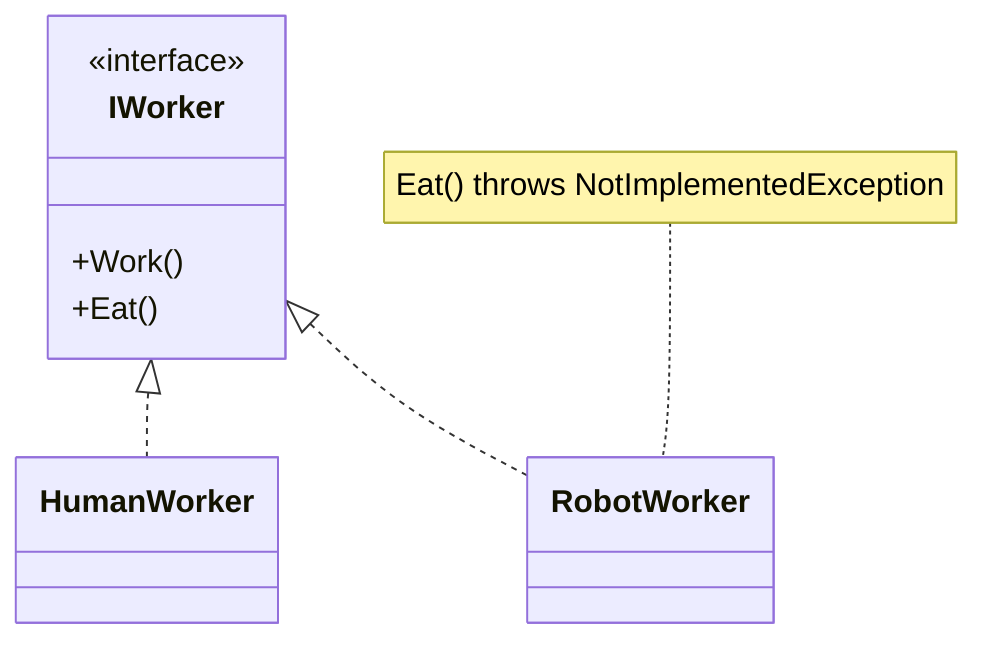
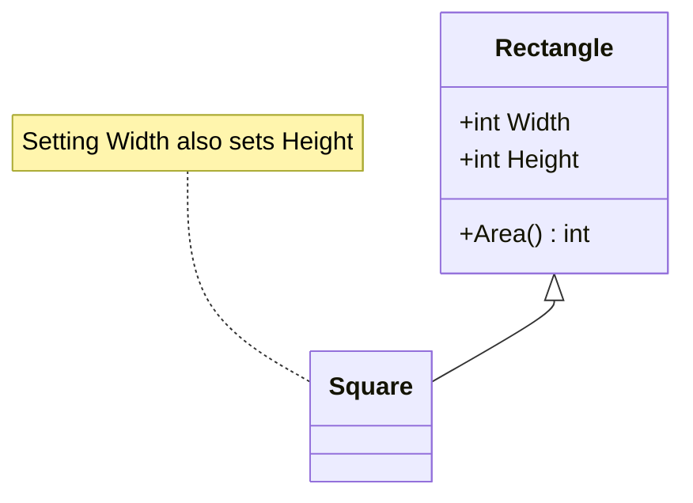
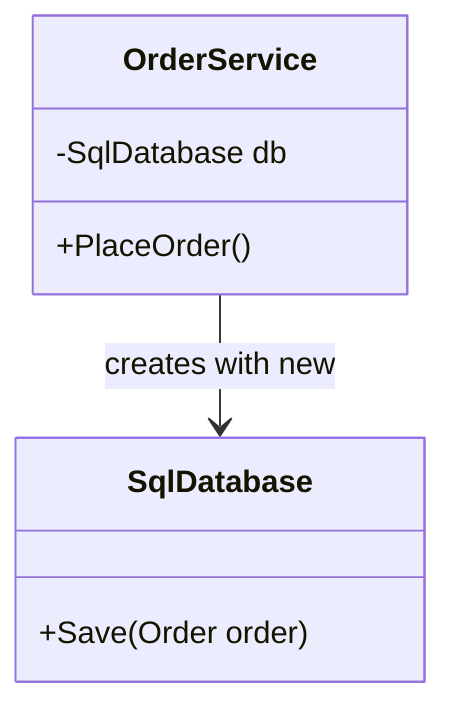
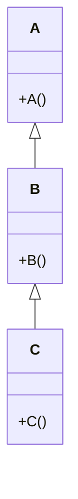
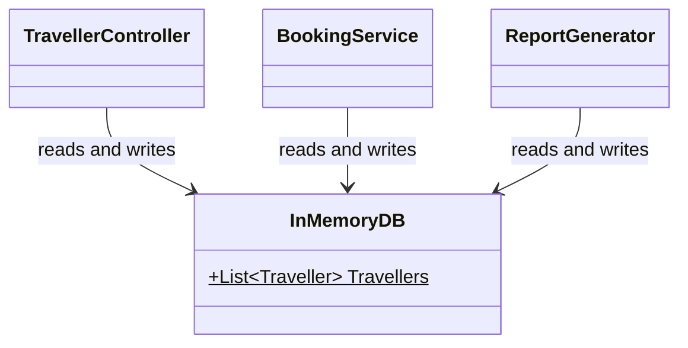
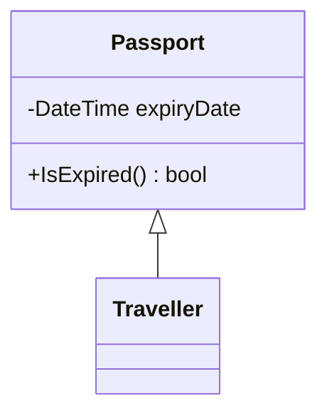
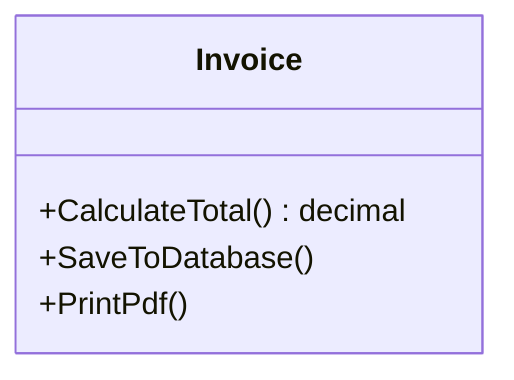

# MCQ Practice

### Q1

In the design below, `RobotWorker` cannot eat, so its `Eat()` throws `NotImplementedException`. Which SOLID principle does the design of the `IWorker` interface violate?



**a.** Single Responsibility Principle.\
**b.** Open-Closed Principle.\
**c.** Dependency Inversion Principle.\
**d.** Liskov Substitution Principle.\
**e.** Interface Segregation Principle.

### Q2

What does `new Car();` print?

```csharp
class Vehicle {
    public Vehicle(int wheels) {
        Console.Write(wheels);
    }
}

class Car : Vehicle {
    public Car() : base(4) {
        Console.Write("Car");
    }
}
```

**a.** Car4\
**b.** Car\
**c.** 4\
**d.** Compile-time error.\
**e.** 4Car

### Q3

Methods in a class are grouped because they must be called in a certain order (e.g. `CheckPassword()` then `LoadMenu()`), even though they work on different data. This is an example of:

**a.** Procedural cohesion\
**b.** Sequential cohesion\
**c.** Functional cohesion\
**d.** Logical cohesion\
**e.** Communicational cohesion

### Q4

What does the code below print?

```csharp
void AddTen(int x) {
    x += 10;
}

void AddTenRef(ref int x) {
    x += 10;
}

int a = 5;
int b = 5;
AddTen(a);
AddTenRef(ref b);
Console.Write(a + " " + b);
```

**a.** `5 5`\
**b.** `15 15`\
**c.** `15 5`\
**d.** `5 15`\
**e.** Compile-time error.

### Q5

Which of the following is NOT one of the SOLID principles?

**a.** Open-Closed Principle.\
**b.** Liskov Substitution Principle.\
**c.** Don't Repeat Yourself.\
**d.** Interface Segregation Principle.\
**e.** Dependency Inversion Principle.

### Q6

In a booking app, `BookingService` depends on `IFlightRepository`. Switching from `InMemoryFlightRepository` to `SqlFlightRepository` only requires changing one line in `Main`. Which SOLID principle mainly makes this possible?

**a.** Single Responsibility Principle.\
**b.** Liskov Substitution Principle.\
**c.** Interface Segregation Principle.\
**d.** Dependency Inversion Principle.\
**e.** None of the above.

### Q7

A well-designed system should aim for:

**a.** Low cohesion and low coupling.\
**b.** Low cohesion and high coupling.\
**c.** High cohesion and low coupling.\
**d.** High cohesion and high coupling.\
**e.** Cohesion and coupling do not matter.

### Q8

What does the code below do?

```csharp
class Traveller {
    public virtual double GetDiscount() {
        return 0;
    }
}

class GoldTraveller : Traveller {
    public override double GetDiscount() {
        return 0.2;
    }
}

List<Traveller> travellers = new List<Traveller>();
travellers.Add(new Traveller());
travellers.Add(new GoldTraveller());

foreach (Traveller t in travellers) {
    Console.Write(t.GetDiscount() + " ");
}
```

**a.** Compile-time error, because a `List<Traveller>` cannot store a `GoldTraveller`.\
**b.** Prints `0 0`, because the list only knows about `Traveller`.\
**c.** Prints `0 0.2`.\
**d.** Throws `InvalidCastException` at run time.\
**e.** Prints `0.2 0.2`.

### Q9

Cohesion measures:

**a.** How many classes depend on a class.\
**b.** How fast a class runs.\
**c.** How many lines of code a class has.\
**d.** How many interfaces a class implements.\
**e.** How closely related the responsibilities inside a single class or module are.

### Q10

The interface `ISuperMachine` declares `Print()`, `Scan()` and `Fax()`. A team adds a new method `Staple()` to it. What is the main problem in a large codebase?

**a.** The interface becomes slower.\
**b.** Nothing, interfaces can grow freely.\
**c.** Only `SuperMachine` must change.\
**d.** Every class implementing `ISuperMachine`, even simple printers, must now change.\
**e.** The interface can no longer be used as a parameter type.

### Q11

In C#, which statement about `ref` and `out` parameters is correct?

**a.** `ref` and `out` behave exactly the same.\
**b.** A `ref` variable must be assigned before it is passed in; an `out` parameter must be assigned inside the method before it returns.\
**c.** An `out` variable must be assigned before it is passed in; a `ref` parameter must be assigned inside the method.\
**d.** Both only work with reference types such as classes.\
**e.** Both pass a copy of the value, so the caller never sees changes.

### Q12

`Print(report, true)` prints a PDF and `Print(report, false)` prints plain text. The caller passes a flag that decides what the method does. Which type of coupling is this?

**a.** Data coupling\
**b.** Stamp coupling\
**c.** Control coupling\
**d.** Content coupling\
**e.** Common coupling

### Q13

`Penguin` inherits from `Bird`, and `Penguin.Fly()` throws an exception. Which redesign best fixes the problem?

**a.** Wrap every call to `Fly()` in a try-catch.\
**b.** Move `Fly()` into a separate `FlyingBird` class (or `IFlyable` interface) that only flying birds use.\
**c.** Make `Penguin.Fly()` do nothing and return silently.\
**d.** Make `Bird` a sealed class.\
**e.** Check `if (bird is Penguin)` before every call to `Fly()`.

### Q14

What does the code below print?

```csharp
class A {
    public void Show() {
        Console.Write("A");
    }
}

class B : A {
    public new void Show() {
        Console.Write("B");
    }
}

A obj = new B();
obj.Show();
```

**a.** A\
**b.** B\
**c.** AB\
**d.** BA\
**e.** Compile-time error.

### Q15

`Notification` depends on the `IMessage` interface instead of the `Email` class. What effect does this have?

**a.** It reduces coupling, so Notification works with any IMessage (Email, WhatsApp) without changes.\
**b.** It increases coupling between Notification and Email.\
**c.** It increases the cohesion of Email.\
**d.** It makes Notification an anemic model.\
**e.** It has no effect.

### Q16

`BankAccount.Withdraw(amount)` accepts any positive amount. A child class `StudentAccount` overrides it and throws an exception when `amount > 100`. Code that works with `BankAccount` now breaks when given a `StudentAccount`. Which SOLID principle is violated?

**a.** Interface Segregation Principle.\
**b.** Single Responsibility Principle.\
**c.** Dependency Inversion Principle.\
**d.** Liskov Substitution Principle.\
**e.** Open-Closed Principle.

### Q17

Which type of coupling is the loosest (most desirable)?

**a.** Content coupling\
**b.** Common coupling\
**c.** Control coupling\
**d.** Stamp coupling\
**e.** Data coupling

### Q18

What happens when the code below is compiled?

```csharp
void GetAge(out int age) {
    Console.Write("Hello");
}
```

**a.** It compiles, and `age` is 0 after the call.\
**b.** It compiles, and `age` keeps the value it had before the call.\
**c.** It compiles, but throws an exception at run time.\
**d.** It compiles only if the caller initialises `age` first.\
**e.** Compile-time error, because an `out` parameter must be assigned before the method returns.

### Q19

In the design below, setting `Width` on a `Square` also changes its `Height`. A method that takes a `Rectangle`, sets `Width = 5` and `Height = 4`, then expects `Area() == 20`, fails when given a `Square`. Which SOLID principle is violated?



**a.** Single Responsibility Principle.\
**b.** Open-Closed Principle.\
**c.** Liskov Substitution Principle.\
**d.** Interface Segregation Principle.\
**e.** Dependency Inversion Principle.

### Q20

A `TaxCalculator` class where every field and method contributes to one task, calculating income tax, is an example of:

**a.** Functional cohesion\
**b.** Sequential cohesion\
**c.** Communicational cohesion\
**d.** Logical cohesion\
**e.** Temporal cohesion

### Q21

`SendWelcomeEmail(Traveller traveller)` only uses `traveller.Email`, but receives the whole `Traveller` object. Which type of coupling is this?

**a.** Stamp coupling\
**b.** Data coupling\
**c.** Control coupling\
**d.** Common coupling\
**e.** Content coupling

### Q22

A `Utils` class contains `FormatDate()`, `CalculateTax()` and `SendEmail()`, which have nothing in common. This is an example of:

**a.** Coincidental cohesion\
**b.** Logical cohesion\
**c.** Temporal cohesion\
**d.** Functional cohesion\
**e.** Sequential cohesion

### Q23

`GoldTraveller` inherits from `Traveller`. What happens with the code below?

```csharp
List<GoldTraveller> golds = new List<GoldTraveller>();
List<Traveller> travellers = golds;
```

**a.** It compiles, because a `GoldTraveller` is a `Traveller`.\
**b.** It compiles, but throws `InvalidCastException` at run time.\
**c.** It compiles, and `travellers` becomes a copy of `golds`.\
**d.** Compile-time error: a `List<GoldTraveller>` is not a `List<Traveller>`, even though a `GoldTraveller` is a `Traveller`.\
**e.** None of the above.

### Q24

How should the class below be changed to follow the Dependency Inversion Principle?

```csharp
class OrderService {
    private SqlDatabase db = new SqlDatabase();
}
```

**a.** Make `SqlDatabase` a static class.\
**b.** Make `OrderService` inherit from `SqlDatabase`.\
**c.** Depend on an `IDatabase` interface and receive it through the constructor.\
**d.** Copy the database code into `OrderService`.\
**e.** Make the `db` field public.

### Q25

A `CustomerReport` class has methods that print a customer's details, update the customer's address and calculate the customer's balance. All the methods work on the same customer record. This is an example of:

**a.** Logical cohesion\
**b.** Temporal cohesion\
**c.** Communicational cohesion\
**d.** Coincidental cohesion\
**e.** Procedural cohesion

### Q26

In C#, when is the method to call decided for overloading and for overriding?

**a.** Overloading is decided at compile time; overriding is decided at run time.\
**b.** Both are decided at compile time.\
**c.** Both are decided at run time.\
**d.** Overloading is decided at run time; overriding is decided at compile time.\
**e.** Neither is decided until the method is called twice.

### Q27

`TravellerController.Book()` checks the traveller's points, subtracts the cost, and prints "Booked!" with `Console.WriteLine`, while `Traveller` only has `{ get; set; }` properties. Which statement is the most accurate?

**a.** This is the recommended "fat model, thin controller" design.\
**b.** The controller is a good example of the Interface Segregation Principle.\
**c.** This is a fat controller with an anemic model: the controller does the Model's job and the View's job.\
**d.** This follows MVC because all the code is in one place.\
**e.** None of the above.

### Q28

Which list orders cohesion from WORST to BEST?

**a.** Functional, Sequential, Communicational, Procedural, Temporal, Logical, Coincidental.\
**b.** Coincidental, Temporal, Logical, Functional, Procedural, Communicational, Sequential.\
**c.** Logical, Coincidental, Temporal, Procedural, Sequential, Communicational, Functional.\
**d.** Coincidental, Logical, Temporal, Procedural, Communicational, Sequential, Functional.\
**e.** Temporal, Coincidental, Logical, Procedural, Functional, Sequential, Communicational.

### Q29

A `DiscountCalculator` has a `switch` on the customer type that must be edited every time a new customer type is added. What is the best way to fix it?

**a.** Add a comment reminding developers to update the switch.\
**b.** Replace the switch with a chain of if-else statements.\
**c.** Move the switch into the Main method.\
**d.** Make the customer type a public field so any class can change it.\
**e.** Give each customer type its own class that overrides a virtual `GetDiscount()` method.

### Q30

`InputHandler.Handle(int source)` reads from the keyboard, a file or the network depending on the `source` flag. The parts are grouped because they are the same kind of thing (input), not because they work together. This is an example of:

**a.** Coincidental cohesion\
**b.** Logical cohesion\
**c.** Temporal cohesion\
**d.** Sequential cohesion\
**e.** Functional cohesion

### Q31

Class `A` changes a private field of class `B` directly using reflection. Which type of coupling is this?

**a.** Data coupling\
**b.** Stamp coupling\
**c.** Control coupling\
**d.** Content coupling\
**e.** Common coupling

### Q32

A `Startup` class contains `InitLogger()`, `LoadConfig()` and `OpenDatabase()`. They are grouped only because they all run when the program starts. This is an example of:

**a.** Coincidental cohesion\
**b.** Logical cohesion\
**c.** Temporal cohesion\
**d.** Communicational cohesion\
**e.** Functional cohesion

### Q33

Which pair of methods is a valid overload in the same class?

**a.** `int Add(int a, int b)` and `double Add(int a, int b)`\
**b.** `void Print(int x)` and `void Print(int y)`\
**c.** `void Print(int x)` and `void Print(string x)`\
**d.** `void Print(int x)` and `void PrintInt(int x)`\
**e.** None of the above.

### Q34

A `DiscountCalculator` has a `switch` on the customer type ("Regular", "Silver", "Gold"). Every time a new customer type is added, a developer must edit this `switch`. Which SOLID principle is violated?

**a.** Single Responsibility Principle.\
**b.** Open-Closed Principle.\
**c.** Liskov Substitution Principle.\
**d.** Interface Segregation Principle.\
**e.** Dependency Inversion Principle.

### Q35

In the design below, `OrderService` creates its own `SqlDatabase` with `new SqlDatabase()`. Which SOLID principle does this violate most directly?



**a.** Liskov Substitution Principle.\
**b.** Interface Segregation Principle.\
**c.** Open-Closed Principle.\
**d.** Single Responsibility Principle.\
**e.** Dependency Inversion Principle.

### Q36

Each constructor below writes its own class name with `Console.Write`. What does `new C();` print?



**a.** C\
**b.** CBA\
**c.** ABC\
**d.** AC\
**e.** Compile-time error.

### Q37

Which statement best describes "one reason to change" in the Single Responsibility Principle?

**a.** A class should have only one method.\
**b.** A class should have only one field.\
**c.** A class should have only one job, so only changes to that job affect it.\
**d.** A class should be changed at most once.\
**e.** A class should never be changed after release.

### Q38

`GoldTraveller` inherits from `Traveller`, and `golds` is a `List<GoldTraveller>`. Which line compiles?

**a.** `List<Traveller> a = golds;`\
**b.** `IEnumerable<Traveller> b = golds;`\
**c.** `List<object> c = golds;`\
**d.** `GoldTraveller d = golds;`\
**e.** None of the above.

### Q39

What does the code below print?

```csharp
class Animal { }
class Dog : Animal { }

void Speak(Animal a) {
    Console.Write("Animal ");
}

void Speak(Dog d) {
    Console.Write("Dog ");
}

Animal pet = new Dog();
Speak(pet);
Speak(new Dog());
```

**a.** `Dog Dog`\
**b.** `Animal Dog`\
**c.** `Animal Animal`\
**d.** `Dog Animal`\
**e.** Compile-time error, because the call is ambiguous.

### Q40

In the design below, several classes read and write `InMemoryDB.Travellers`, a `public static` list. Which type of coupling is this?



**a.** Data coupling\
**b.** Common coupling\
**c.** Stamp coupling\
**d.** Control coupling\
**e.** Content coupling

### Q41

Which is a typical consequence of tight coupling?

**a.** Classes can easily be tested in isolation.\
**b.** Classes can easily be reused in other projects.\
**c.** Changes always stay inside one class.\
**d.** A change in one class forces changes in other classes, and testing in isolation becomes hard.\
**e.** The program always runs faster.

### Q42

What happens when the code below is compiled?

```csharp
class Person {
    public Person(string name) { }
}

class Student : Person {
    public Student() { }
}
```

**a.** It compiles, and Person's constructor is skipped.\
**b.** It compiles, and name is set to null.\
**c.** It compiles, but throws an exception at run time.\
**d.** Compile-time error, because Person has no parameterless constructor and Student does not call base(...).\
**e.** None of the above.

### Q43

A developer designs the classes below so that `Traveller` can reuse `IsExpired()`. What is the better design?



**a.** Make `Passport` inherit from `Traveller`.\
**b.** Make `IsExpired()` static.\
**c.** Copy `IsExpired()` into `Traveller`.\
**d.** Make `Passport` an interface with all of Traveller's methods.\
**e.** Use composition: `Traveller` has a private `Passport` field and calls `passport.IsExpired()`.

### Q44

A class has `ReadFile()`, `ParseLines()` and `SaveRecords()`, where the output of each method is the input of the next, like an assembly line. This is an example of:

**a.** Procedural cohesion\
**b.** Communicational cohesion\
**c.** Temporal cohesion\
**d.** Sequential cohesion\
**e.** Coincidental cohesion

### Q45

To override a method in C#, which keywords are needed in the parent and in the child?

**a.** Parent: nothing. Child: `override`.\
**b.** Parent: `override`. Child: `virtual`.\
**c.** Parent: `new`. Child: `override`.\
**d.** Parent: `virtual` (or `abstract`). Child: `override`.\
**e.** Parent: `static`. Child: `override`.

### Q46

A `ReportGenerator` class loads sales data from the database, formats it as HTML, and emails it to the manager. Which description fits best?

**a.** Low cohesion and a violation of SRP; it should be split into separate classes for loading, formatting and sending.\
**b.** High cohesion, and it follows SRP.\
**c.** Loose coupling, and it follows ISP.\
**d.** Functional cohesion, and it follows OCP.\
**e.** None of the above.

### Q47

Which SOLID principle does the `Invoice` class below violate?



**a.** Single Responsibility Principle.\
**b.** Open-Closed Principle.\
**c.** Liskov Substitution Principle.\
**d.** Interface Segregation Principle.\
**e.** Dependency Inversion Principle.

### Q48

What does `new B();` print?

```csharp
class A {
    public A() {
        Show();
    }
    public virtual void Show() {
        Console.Write("A");
    }
}

class B : A {
    private string name = "B";

    public B() {
        name = "C";
    }
    public override void Show() {
        Console.Write(name);
    }
}
```

**a.** A\
**b.** B\
**c.** C\
**d.** Nothing, because name is still null.\
**e.** Compile-time error.

---

## Answer key

| Q | Answer | Q | Answer | Q | Answer |
| - | - | - | - | - | - |
| [Q1](#q1) | e | [Q17](#q17) | e | [Q33](#q33) | c |
| [Q2](#q2) | e | [Q18](#q18) | e | [Q34](#q34) | b |
| [Q3](#q3) | a | [Q19](#q19) | c | [Q35](#q35) | e |
| [Q4](#q4) | d | [Q20](#q20) | a | [Q36](#q36) | c |
| [Q5](#q5) | c | [Q21](#q21) | a | [Q37](#q37) | c |
| [Q6](#q6) | d | [Q22](#q22) | a | [Q38](#q38) | b |
| [Q7](#q7) | c | [Q23](#q23) | d | [Q39](#q39) | b |
| [Q8](#q8) | c | [Q24](#q24) | c | [Q40](#q40) | b |
| [Q9](#q9) | e | [Q25](#q25) | c | [Q41](#q41) | d |
| [Q10](#q10) | d | [Q26](#q26) | a | [Q42](#q42) | d |
| [Q11](#q11) | b | [Q27](#q27) | c | [Q43](#q43) | e |
| [Q12](#q12) | c | [Q28](#q28) | d | [Q44](#q44) | d |
| [Q13](#q13) | b | [Q29](#q29) | e | [Q45](#q45) | d |
| [Q14](#q14) | a | [Q30](#q30) | b | [Q46](#q46) | a |
| [Q15](#q15) | a | [Q31](#q31) | d | [Q47](#q47) | a |
| [Q16](#q16) | d | [Q32](#q32) | c | [Q48](#q48) | b |

---

## Solutions

**[Q1](#q1) — e.** Interface Segregation Principle

`IWorker` is a fat interface: it forces `RobotWorker` to have an `Eat()` it can't do. The fix is to split it into small interfaces like `IWorkable` and `IEatable`, so each class only picks what it can do. (The throwing `Eat()` also smells like LSP, but the question asks what's wrong with the *interface*.)

**[Q2](#q2) — e.** 4Car

The parent constructor always runs first. `base(4)` passes 4 to `Vehicle`, which prints `4`, then the `Car` body prints `Car`.

**[Q3](#q3) — a.** Procedural cohesion

The methods are grouped because they run in a fixed order, but they don't pass data to each other. If the output of one were the input of the next, it would be sequential cohesion instead.

**[Q4](#q4) — d.** `5 15`

`AddTen(a)` gets a **copy** of `a`, so the change is lost and `a` stays 5. `AddTenRef(ref b)` gets the variable itself, so `b` really becomes 15.

**[Q5](#q5) — c.** Don't Repeat Yourself

SOLID is Single responsibility, Open-closed, Liskov substitution, Interface segregation and Dependency inversion. DRY (Don't Repeat Yourself) is a good rule, but it's not part of SOLID.

**[Q6](#q6) — d.** Dependency Inversion Principle

`BookingService` depends on the `IFlightRepository` interface, not on a concrete class. The real repository is plugged in from outside (in `Main`), so swapping it doesn't touch the service. That's dependency inversion.

**[Q7](#q7) — c.** High cohesion and low coupling

High cohesion means each class does one focused job. Low coupling means classes don't depend much on each other's details. Together they make code easy to change and test.

**[Q8](#q8) — c.** Prints `0 0.2`

A `List<Traveller>` can hold a `GoldTraveller`, because a `GoldTraveller` **is a** `Traveller`. `GetDiscount()` is `virtual`/`override`, so each object runs its own version: `0` for `Traveller`, `0.2` for `GoldTraveller`. This is polymorphism.

**[Q9](#q9) — e.** How closely related the responsibilities inside a single class or module are

Cohesion is about what's **inside** one class: do its parts belong together? Coupling is about how much **different** classes depend on each other.

**[Q10](#q10) — d.** Every class implementing `ISuperMachine`, even simple printers, must now change

Every class that implements an interface must implement all of its methods. Adding `Staple()` forces every implementer to change, even a simple printer that can't staple. This is why ISP matters in big codebases.

**[Q11](#q11) — b.** A `ref` variable must be assigned before it is passed in; an `out` parameter must be assigned inside the method before it returns

`ref` passes a variable that already has a value (the method can read and change it). `out` is for returning a value: the caller doesn't need to set it first, but the method **must** assign it before it returns.

**[Q12](#q12) — c.** Control coupling

The flag (`true`/`false`) controls which path runs inside `Print`. When one module tells another *how* to behave, that's control coupling. Two clearer methods, `PrintPdf()` and `PrintText()`, would remove it.

**[Q13](#q13) — b.** Move `Fly()` into a separate `FlyingBird` class (or `IFlyable` interface) that only flying birds use

A `Penguin` can't stand in for a `Bird` if every `Bird` can fly, which breaks LSP. Moving `Fly()` into `FlyingBird` (or an `IFlyable` interface) means only birds that can fly promise to fly. Doing nothing silently (c) still breaks what callers expect.

**[Q14](#q14) — a.** A

`new` **hides** the parent method instead of overriding it. With hiding, the **variable's type** decides which method runs. `obj` is declared as `A`, so `A.Show()` runs. With `virtual`/`override` it would print `B`.

**[Q15](#q15) — a.** It reduces coupling, so Notification works with any IMessage (Email, WhatsApp) without changes

`Notification` only knows the `IMessage` interface, so it isn't tied to `Email`. Any class that implements `IMessage` can be passed in, which is loose coupling (and DIP).

**[Q16](#q16) — d.** Liskov Substitution Principle

A child must work anywhere the parent works. `StudentAccount` adds a stricter rule (max 100) that callers of `BankAccount` don't expect, so swapping it in breaks their code. That breaks LSP.

**[Q17](#q17) — e.** Data coupling

Data coupling means modules only share the simple data they need, such as `int` or `string` parameters. From worst to best: content, common, control, stamp, data.

**[Q18](#q18) — e.** Compile-time error, because an `out` parameter must be assigned before the method returns

An `out` parameter **must** be assigned on every path before the method returns. `GetAge` never sets `age`, so the compiler rejects it.

**[Q19](#q19) — c.** Liskov Substitution Principle

Code written for a `Rectangle` expects `Width` and `Height` to change separately. A `Square` breaks that expectation, so it can't safely replace a `Rectangle`. That's an LSP violation, even though "a square is a rectangle" in maths.

**[Q20](#q20) — a.** Functional cohesion

Every part of `TaxCalculator` works towards one single, well-defined task. That's functional cohesion, the best kind.

**[Q21](#q21) — a.** Stamp coupling

Passing a whole object when only one field is needed is stamp coupling. `SendWelcomeEmail` now depends on the whole `Traveller` class. Passing just the email string would be data coupling.

**[Q22](#q22) — a.** Coincidental cohesion

The methods are in one class by chance, with no real relationship. That's coincidental cohesion, the worst kind. A `Utils` dumping ground is the classic example.

**[Q23](#q23) — d.** Compile-time error: a `List<GoldTraveller>` is not a `List<Traveller>`, even though a `GoldTraveller` is a `Traveller`

A `GoldTraveller` is a `Traveller`, but a `List<GoldTraveller>` is **not** a `List<Traveller>`. If it were, you could do `travellers.Add(new Traveller())` and put a plain `Traveller` into a list that should only hold Gold ones. So the compiler refuses.

**[Q24](#q24) — c.** Depend on an `IDatabase` interface and receive it through the constructor

Depend on an interface and let the caller pass the real database in through the constructor (dependency injection). Then `OrderService` works with any `IDatabase`, such as SQL now or in-memory for tests.

**[Q25](#q25) — c.** Communicational cohesion

All the methods work on the **same data**, the customer record. That's communicational cohesion.

**[Q26](#q26) — a.** Overloading is decided at compile time; overriding is decided at run time

Overloads are picked by the **compiler**, using the declared types of the arguments. Overrides are picked at **run time**, using the actual object (dynamic dispatch).

**[Q27](#q27) — c.** This is a fat controller with an anemic model: the controller does the Model's job and the View's job

The controller holds the business rule (points, cost) **and** prints output, so it's doing the Model's and the View's jobs. Meanwhile `Traveller` is just data. MVC says: fat model, thin controller.

**[Q28](#q28) — d.** Coincidental, Logical, Temporal, Procedural, Communicational, Sequential, Functional

From worst to best: coincidental, logical, temporal, procedural, communicational, sequential, functional.

**[Q29](#q29) — e.** Give each customer type its own class that overrides a virtual `GetDiscount()` method

Give each customer type its own class with its own `GetDiscount()`. Adding a new type means adding a new class, without editing tested code. That's OCP done with polymorphism.

**[Q30](#q30) — b.** Logical cohesion

The parts are grouped because they're the same *kind* of thing (input), and a flag picks which one runs. That's logical cohesion.

**[Q31](#q31) — d.** Content coupling

One class reaching into another's private internals is content coupling, the tightest (worst) kind. Any change inside `B` can break `A`.

**[Q32](#q32) — c.** Temporal cohesion

The methods are grouped only because they run at the same **time** (start-up). That's temporal cohesion.

**[Q33](#q33) — c.** `void Print(int x)` and `void Print(string x)`

Overloads must have the **same name** but a **different parameter list** (different types, number or order). A different return type alone (a) or only a different parameter name (b) isn't enough, and (d) just uses a different name.

**[Q34](#q34) — b.** Open-Closed Principle

Every new customer type means editing the existing `switch`. Code should be open for extension (add a new class) but closed for modification (don't edit what already works).

**[Q35](#q35) — e.** Dependency Inversion Principle

`OrderService` (high-level) creates and depends on the concrete `SqlDatabase` (low-level). DIP says both should depend on an abstraction such as `IDatabase`.

**[Q36](#q36) — c.** ABC

Constructors run from the top of the hierarchy down: `A` first, then `B`, then `C`, so it prints `ABC`.

**[Q37](#q37) — c.** A class should have only one job, so only changes to that job affect it

"One reason to change" means one job. If a class has several jobs, changes to any of them force edits to the same class.

**[Q38](#q38) — b.** `IEnumerable<Traveller> b = golds;`

`IEnumerable<T>` is covariant (`out T`): you can only read from it, never add, so treating a list of Gold travellers as a sequence of `Traveller` is safe. `List<T>` allows adding, so (a) and (c) don't compile, and (d) assigns a list to a single object.

**[Q39](#q39) — b.** `Animal Dog`

Overloads are chosen at **compile time** from the **declared** type. `pet` is declared as `Animal`, so `Speak(Animal)` runs and prints `Animal`, even though the object is a `Dog`. `new Dog()` has type `Dog`, so it prints `Dog`.

**[Q40](#q40) — b.** Common coupling

Several classes share a global (static) variable, so a change made in one place affects all of them. That's common coupling. Passing a repository in through an interface would fix it.

**[Q41](#q41) — d.** A change in one class forces changes in other classes, and testing in isolation becomes hard

With tight coupling, classes know too much about each other, so changes ripple from one class to another, and you can't test one class without bringing the others along.

**[Q42](#q42) — d.** Compile-time error, because Person has no parameterless constructor and Student does not call base(...)

Every child constructor calls a parent constructor first. Without `: base(...)`, C# tries to call `Person()` with no arguments, which doesn't exist, so it won't compile. The fix is `public Student() : base("name") { }`.

**[Q43](#q43) — e.** Use composition: `Traveller` has a private `Passport` field and calls `passport.IsExpired()`

A Traveller **has a** passport; it is not a passport. Use composition (keep a `Passport` field) instead of inheritance. Rule of thumb: is-a → inheritance, has-a → composition.

**[Q44](#q44) — d.** Sequential cohesion

Each method's output is the next method's input, like an assembly line. That's sequential cohesion.

**[Q45](#q45) — d.** Parent: `virtual` (or `abstract`). Child: `override`

The parent must allow overriding with `virtual` (or `abstract`, which forces it). The child uses `override`. Without `virtual`, the child can only hide the method with `new`.

**[Q46](#q46) — a.** Low cohesion and a violation of SRP; it should be split into separate classes for loading, formatting and sending

Loading, formatting and emailing are three jobs that change for different reasons. The class has low cohesion and breaks SRP. Split it into a loader, a formatter and a sender.

**[Q47](#q47) — a.** Single Responsibility Principle

`Invoice` has three jobs: calculating, saving and printing. A change to the database or to the PDF layout would both force edits to `Invoice`. Split it into separate classes.

**[Q48](#q48) — b.** B

Field initialisers run **before** any constructor, including the parent's, so `name` is already `"B"`. The `A` constructor then calls `Show()`, which is virtual, so `B.Show()` runs and prints `B`. Only after that does the `B` constructor body set `name` to `"C"`.
